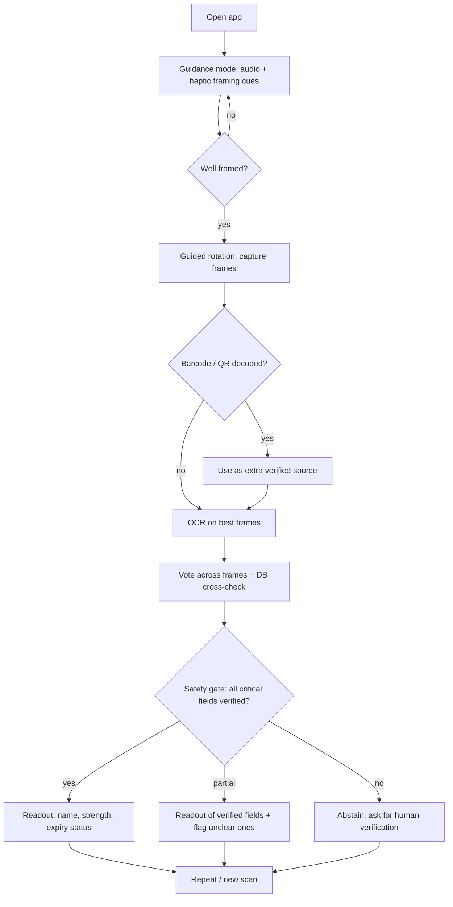

# Product Requirements Document (PRD)

**Product (working title):** Offline Medicine Label Reader for the Visually Impaired
**Platform:** Android (native, Kotlin), open-source
**Version:** 0.1 (Draft) | **Status:** For review | **Next docs:** TRD → System Architecture → Database Design → Frontend/Accessibility UX

---

## 1. Summary

An open-source, zero-budget, 100% offline Android app that lets blind and low-vision people in India read the critical facts on a medicine pack (brand name, strength, expiry) independently and safely.

Three ideas define the product:

1. **Guided framing.** Before capture, live computer vision tells the user, through audio and haptics, how to position the pack.
2. **Verified reading only.** The app reads several frames, votes across them, cross-checks against a local Indian drug database, and speaks a value only when it is verified.
3. **Safe abstention.** When verification fails, the app says so and asks the user to get human help. It never guesses.

---

## 2. Problem Statement

| # | Problem | Consequence |
|---|---|---|
| P1 | Blind users cannot tell whether a pack is fully in frame, in focus, or well lit. | Truncated captures produce partial reads (e.g., "10 mg" read from "100 mg"). |
| P2 | Medicine packaging is worst-case for OCR: curved bottles, foil glare, faded ink, small print (often around 9 pt), inkjet batch/expiry codes. | Generic reader apps make errors that are invisible to the user. |
| P3 | Labels mix English with Devanagari and other scripts. | Regional-script text is often skipped or misread. |
| P4 | Language models and OCR can "correct" or invent text (phantom characters, autocorrected drug names, altered digits). | A confident wrong answer about a medicine can cause harm. |
| P5 | Cloud-based readers need connectivity and money, and they send health-related images off the device. | Unusable in low-connectivity areas, unaffordable at scale, and a privacy exposure under the DPDP Act, 2023. |

> Field context (NAB and XRCVC engagements, per the research report) identified camera framing as the primary operational bottleneck. Validate all problem statements with user sessions before the demo (see §9).

---

## 3. Goals and Non-Goals

### Goals
- **G1.** Enable independent reading of brand name, strength and expiry from common Indian medicine packaging.
- **G2.** Make silent errors (confident but wrong output) as close to zero as measurement can show, and report the evidence.
- **G3.** Run fully offline on a ₹10-15k Android phone, with no network permission at all.
- **G4.** Be operable entirely via TalkBack with a minimal, predictable interface.
- **G5.** Ship as an open-source project with a reproducible evaluation harness.

### Non-Goals (MVP)
- Medical advice: dosing instructions, drug interactions, or "how to take" guidance.
- Reading handwritten prescriptions or prescription pads.
- iOS, accounts/auth, cloud sync, email, analytics, or telemetry.
- General document reading (bills, forms, currency). Post-MVP.
- Braille or QR-voice integration with manufacturers. Post-MVP, design for forward compatibility only.

---

## 4. Target Audience

| Persona | Description | Key needs | Priority |
|---|---|---|---|
| **P1: Independent TalkBack user** | Blind adult, comfortable with TalkBack, budget Android phone | Predictable gestures, fast readout, trustworthy output | Primary |
| **P2: Low-vision older adult** | Some residual vision, less familiar with screen readers | Large high-contrast UI, simple flow, slow clear speech | Primary |
| **P3: Family caregiver** | Sighted person helping to verify medicines | Quick second-opinion check | Secondary |

Personas are hypotheses. Validate with NAB and XRCVC before the demo.

**Context constraints:** low-end hardware (3-4 GB RAM typical), variable lighting, intermittent or no connectivity, English/Hindi/Marathi as initial languages.

---

## 5. What the App Reads

| Field | Priority | Rule |
|---|---|---|
| Brand name | P0 | Spoken only if verified (§7, F3/F4). |
| Strength (with unit) | P0 | Spoken only if it passes multi-frame agreement and DB validity. Compound forms such as `125 mg/5 ml` are treated as one value. |
| Expiry (month/year) | P0 | Spoken with status: valid, or **expired** (compared with the device date). |
| Generic/composition text | P1 | Read as printed on the label. The DB is used only to validate it. |
| Rx/Schedule warning present | P1 | "Prescription-only warning printed on this pack". |
| Manufacturer, batch, MFG date | P2 | Read on request. |
| Dosing/usage directions | Non-goal | Not read or generated in MVP. |

**Principle:** the database *checks* what the camera read. It never *supplies* values that were not read from the label.

---

## 6. Core User Journeys

### J0. First run (once)
1. App speaks a short introduction and the assistive-tool disclaimer: it is not a substitute for a pharmacist or doctor.
2. User chooses language (English / Hindi / Marathi) and confirms with one action.
3. App checks that offline text-to-speech voice data is installed for the chosen language. If not, it explains how to install it once while online, and falls back to English meanwhile.
4. A 30-second spoken practice scan with a sample item.

### J1. Guided scan and audio readout (happy path)

1. User opens the app. It announces: "Ready. Hold the medicine in front of the camera."
2. **Guidance mode:** continuous audio tone and directional haptics. Pitch rises as the pack becomes centered, fully in view, sharp and free of glare. Short spoken hints for "move closer", "too much glare, tilt slightly", "too dark".
3. When framing is good, app says "Hold still. Slowly turn the pack to your right."
4. **Capture:** app buffers frames while the user rotates the pack, and gives progress cues ("keep turning… almost there… done").
5. **Processing mode:** short spoken "Reading." Guidance audio is muted.
6. **Readout mode:** structured, always in the same order, for example: "Crocin. Five-zero-zero milligrams. Expires November 2026. Valid." Followed by "Say or tap for options: repeat, slower, read expiry only."
7. User can repeat, slow down, or start a new scan with one action.

### J2. Barcode/QR fast path
If a machine-readable code is decoded in any frame, the app uses it as an additional verified source and confirms it against label text where possible. Text and code disagreeing triggers abstention.

### J3. Abstention path (safety-critical)
Any critical field that fails verification is not spoken as fact. Example: "Crocin detected, but the strength could not be read reliably. Please ask someone to check it, or a pharmacist." The app offers to try again.

### J4. Edge cases
| Situation | Behavior |
|---|---|
| Too dark or too much glare | Spoken hint, then abstain after a timeout. |
| No label or text found | "I cannot see any label. Try turning the pack." |
| Scan takes too long | Time-boxed. Abstain with a retry offer, never hang silently. |
| Low battery, high temperature | Warn and stop scanning gracefully. |
| Field partially verified | Speak verified fields, explicitly flag the unverified ones. |

---

## 7. Key Features and Requirements

Priorities: P0 = MVP must-have, P1 = should-have, P2 = if time.

### F1. Pre-capture guidance (OpenCV)
| ID | Requirement | Pri | Acceptance criterion |
|---|---|---|---|
| F1.1 | Detect the pack/label region in the live camera stream and compute centering, coverage, sharpness and glare scores. | P0 | Scores logged per frame in the evaluation build. |
| F1.2 | Sonification: tone pitch reflects a combined framing score. | P0 | Verified by eyes-closed testers reaching "good framing" unaided. |
| F1.3 | Directional haptics indicate which way to move. | P0 | Left/right/up/down patterns are distinguishable in user testing. |
| F1.4 | Spoken hints for distance, glare and lighting. | P0 | Hints do not overlap with each other or with readout. |
| F1.5 | Per-frame guidance processing within the latency budget (§8). | P0 | p95 measured on the target device class. |
| F1.6 | User setting: audio only / haptics only / both. | P1 | Setting persists across sessions. |

### F2. Multi-frame capture and OCR
| ID | Requirement | Pri | Acceptance criterion |
|---|---|---|---|
| F2.1 | Guided rotation capture into an in-memory frame buffer. | P0 | No image written to storage. |
| F2.2 | Frame quality scoring (sharpness, glare, coverage); OCR runs on the best N frames, not all frames. | P0 | Total scan time within budget on the target device. |
| F2.3 | On-device OCR (PaddleOCR Mobile) for English; Devanagari if a suitable model is confirmed. | P0 (EN) / P1 (Devanagari) | Per-language accuracy reported in the evaluation. |
| F2.4 | Barcode/QR detection on captured frames. | P1 | Decoded payload is cross-checked against text, never trusted alone. |

### F3. Validation engine
| ID | Requirement | Pri | Acceptance criterion |
|---|---|---|---|
| F3.1 | Deterministic field extraction (strength, expiry, brand candidates) from OCR text using case-insensitive patterns. | P0 | Unit-test suite covers real label formats: `Exp. Date: 11/2026`, `EXPIRY DATE NOV.2026`, `500MG`, `125 mg/5 ml`, `60000 IU`, and MFG-vs-EXP confusion. |
| F3.2 | Digit normalization before extraction (O→0, l/I→1 in numeric context). | P0 | Test: `5O0 mg` resolves to `500 mg`, not `0 mg`. |
| F3.3 | Temporal voting: a value is accepted only if enough frames *where the field was detected* agree (initial threshold: at least 3 agreeing reads and at least 70% agreement among detections, tunable). | P0 | Thresholds justified by evaluation data, not chosen arbitrarily. |
| F3.4 | Brand matching: exact match first. Fuzzy match only if there is no exact match and the best candidate beats the runner-up by a margin, using an OCR-aware edit distance. Brand variants are deduplicated before the uniqueness test. | P0 | Ambiguous cases abstain in tests. |
| F3.5 | Plausibility check: the read strength must be a known strength for the matched brand or composition. | P0 | Implausible strengths abstain even when multi-frame consensus is unanimous. |
| F3.6 | Expiry compared with device date; expired items are announced as expired. | P0 | Verified with test dates. |

### F4. Safety gate and abstention
| Condition | Action | Example spoken output |
|---|---|---|
| All critical fields verified (F3.3-F3.5) | Full readout | "Crocin. Five-zero-zero milligrams. Expires November 2026. Valid." |
| Brand verified, strength not verified | Partial readout, flag | "Crocin detected. Strength is unclear. Please ask someone to check." |
| Brand ambiguous (multiple close DB candidates) | Abstain on brand | "I cannot tell which medicine this is. Please ask for help." |
| Strength not plausible for the brand | Abstain | "The strength I read does not match this medicine. Please ask for help." |
| Text and QR/barcode disagree | Abstain | "The label and the code do not agree. Please ask for help." |
| Expiry unreadable | Flag | "I could not read the expiry date. Please check it with someone." |
| Timeout or no usable frames | Abstain and offer retry | "I could not read this reliably. Try again, or ask for help." |

Rules that never change:
- No unverified value is ever spoken as fact.
- DB-derived values are never presented as "read from the label".
- Every abstention gives the user a next step.

### F5. Offline speech output
| ID | Requirement | Pri |
|---|---|---|
| F5.1 | Use Android's native text-to-speech, fully offline. | P0 |
| F5.2 | English, Hindi, Marathi; detect at startup whether offline voice data is installed and guide the user if not. | P0 |
| F5.3 | Numbers spoken digit by digit for strengths. | P0 |
| F5.4 | Speed control, repeat, and "read only expiry / strength" commands. | P1 |

### F6. Accessible interface
Detailed in the UX document. Summary: minimal screen, large tap area, 48 dp minimum targets, TalkBack labels on every control, high contrast, dynamic text scaling, and a hardware-key alternative for starting a scan.

### F7. Privacy and data handling
- Frames exist only in RAM and are discarded after processing.
- No network permission declared. This is verifiable in the app manifest.
- No analytics, no accounts, no crash-report uploads.
- Evaluation logging (F8) is opt-in, local, and excluded from release builds.

### F8. Evaluation harness (P1, required for metrics)
Local logging of each trial as structured data (frames used, raw OCR, extracted fields, gate decision, spoken string), plus a scoring script that compares trials with a ground-truth sheet.

---

## 8. Non-Functional Requirements

| Category | Requirement (targets to be validated on a real ₹10-15k device) |
|---|---|
| Guidance latency | ≤ 50 ms per frame (p95) |
| Scan-to-readout | Proposed: ≤ 10 s p95 from end of rotation. Note that OCR at 0.5-2 s per frame means OCR must be limited to selected frames. |
| Offline | 100% of features. No INTERNET permission. |
| Privacy | Data minimization by design (DPDP Act, 2023). No health data stored or transmitted. |
| Accessibility | TalkBack-complete, 48 dp minimum targets (beyond WCAG 2.5.8), 4.5:1 contrast, system text scaling. |
| Device class | Low-RAM Android phones; minimum API level to be set in the TRD. |
| Size | Proposed APK budget in the TRD (OCR models + runtime + DB). |
| Thermal/battery | Time-boxed scan sessions; graceful stop when the device throttles. |
| Licensing | Prefer OSI-approved dependencies. Confirm the DB source licence (§11). |

**Regulatory and legal notes**
- Present the app as an assistive tool, not a medical device or advice. Confirm the applicable classification for medical-device software before any public release.
- Disclaimers appear in first-run onboarding and in the About screen.

---

## 9. Success Metrics

| Metric | Definition | Target (proposed, revise after baseline) | Measurement |
|---|---|---|---|
| **Critical-Field Success Rate** | % of trials where brand, strength and expiry are all spoken and all correct | Report per category (strips, bottles, tubes) and per lighting condition | Scoring script over logged trials |
| **Silent Error Rate** | % of trials where a wrong value is spoken confidently | **0 observed**, reported with a 95% upper bound (0 errors in 300 trials ≈ 1%; in 100 trials ≈ 3%). Any silent error blocks release until root-caused. | Same |
| **Abstention Rate** | % of trials where the app declined or flagged a field | Report overall; proposed ≤ 25% on clean labels. Abstention is preferred over risk, so this is a tuning trade-off, not a pure minimization goal. | Same |
| Appropriate abstention | Of trials where the label was genuinely unreadable, % where the app abstained | Track alongside silent error | Manual label review |
| Guidance latency | p95 per-frame processing | ≤ 50 ms | On-device profiling |
| Scan-to-readout time | p95 | Proposed ≤ 10 s | On-device timing |
| Task completion | % of eyes-closed or blind testers completing a scan unaided | Set after pilot | Observed sessions |
| Usability | System Usability Scale | Proposed ≥ 68 | Post-session survey |
| Accessibility audit | TalkBack walkthrough plus Android Accessibility Scanner | Zero blocking issues | Manual + automated |

### Evaluation plan (summary)
- **Sample:** at least 100 physical retail packs (about 40 strips/blisters, 40 bottles, 20 tubes), including foil, curved surfaces, inkjet batch/expiry codes, some Hindi/Marathi labels and some worn items. Use retail packaging only. Avoid or mask prescription labels containing patient names.
- **Conditions:** multiple lighting setups, repeated trials, at least 300 total trials for a meaningful silent-error bound.
- **Ground truth:** spreadsheet of brand, strength, expiry for each item.
- **Human factors:** eyes-closed testing by the team as a minimum. Sessions with NAB or XRCVC participants are the strongest evidence.
- **Reporting:** raw counts, per-category tables, and the confidence bound, not just percentages.

---

## 10. Risks and Mitigations

| Risk | Impact | Mitigation |
|---|---|---|
| Consistent misread repeated in every frame (voting cannot catch it) | Silent error | Independent plausibility check against DB strengths (F3.5), QR cross-check, abstain on conflicts |
| Fuzzy match maps to a look-alike drug | Silent error | Exact-first, margin rule, weighted distance, ambiguity abstains |
| OCR too slow on low-end devices with multiple frames | Poor UX | Quality-scored frame selection, time-boxed pipeline, measure early |
| Offline Hindi/Marathi voice data not installed | Readout unusable in that language | First-run detection and guidance, English fallback |
| DB incomplete, outdated or unlicensed | False abstentions or invalid checks | Verify source licence, document coverage, version the DB |
| Devanagari OCR quality insufficient | Weak regional support | Ship English-first, report Devanagari accuracy honestly, treat as P1 |
| Continuous guidance audio interferes with TTS | Confusing output | Mute guidance during processing and readout |
| Users over-trust the app | Real-world harm | Disclaimers, consistent abstention messages, no dosing advice |
| Regulatory classification uncertainty | Release risk | Check medical-device software rules before public distribution |

---

## 11. Milestones and Definition of Done

| Milestone | Scope | Definition of done |
|---|---|---|
| **M0. Docs** | PRD, TRD, Architecture, DB design, UX | [ ] All five documents reviewed and consistent |
| **M1. Extraction baseline** | On-device OCR plus extraction patterns | [ ] Unit tests pass on all label-format strings [ ] OCR latency measured on a real budget phone |
| **M2. Validation engine** | Voting, DB match, safety gate | [ ] Ambiguity and implausibility cases abstain in tests [ ] Gate logic covered by automated tests |
| **M3. Guidance loop** | OpenCV framing, audio, haptics | [ ] p95 ≤ 50 ms measured [ ] Eyes-closed tester reaches good framing |
| **M4. Speech and UI** | Offline TTS, minimal TalkBack UI | [ ] Full flow works with TalkBack and no network permission |
| **M5. Evaluation and demo** | Harness, 300+ trials, report | [ ] Metrics table with confidence bounds [ ] Demo script prepared [ ] Known limitations documented |

Scope is intentionally tight: no auth, email, cloud, or analytics.

---

## 12. Open Questions

1. Which PaddleOCR release provides a Devanagari recognition model that exports cleanly to the chosen mobile runtime?
2. Is Google ML Kit acceptable under the "open-source" constraint, or should an open-source barcode decoder (e.g., ZXing) be used instead?
3. What is the licence and freshness of the chosen Indian drug database, and does it include strengths per brand? (Generic-only lists such as Jan Aushadhi will not cover brand lookups.)
4. What are the minimum supported Android version and the target device for benchmarking?
5. Will pilot sessions with NAB or XRCVC be possible before the demo?
6. What voice-command layer, if any, is in scope (hardware key and tap only, or speech commands)?
