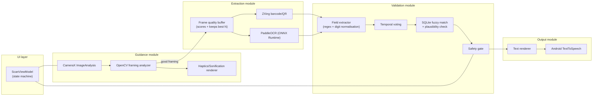

# Technical Requirements Document (TRD)

**Scope:** zero-budget, 100% offline, open-source Android tech stack
**Companion docs:** PRD (01) · System Architecture (03) · Database Design (04) · Frontend/Accessibility UX (05)
**Evidence:** every logic claim below (regex behaviour, distance thresholds, retrieval timing) is backed by a runnable reference implementation and a passing test suite, referenced by name in each section. Numbers marked "desktop" were measured on the build machine in CPython and are directional only — re-profile on the actual target device before locking budgets.

---

## 1. Platform and Stack

| Layer | Choice | Licence | Notes |
|---|---|---|---|
| Language / IDE | Kotlin, Android Studio | Free | Native, no cross-platform runtime |
| Camera | **CameraX** (`ImageAnalysis` + `ImageCapture` use cases) | Apache-2.0 | `ImageAnalysis.Analyzer` feeds the guidance loop at a bounded frame rate; `ImageCapture`-equivalent frames for OCR come from the same buffered analyzer, not a separate shutter |
| Computer vision | **OpenCV Android SDK** (native, via JNI) | Apache-2.0 | Edge/contour detection, sharpness, glare, centering |
| Barcode/QR | **ZXing** (`zxing-android-embedded` or the core `com.google.zxing:core` library called directly) | Apache-2.0 | See decision box below — replaces ML Kit to keep the stack fully open-source |
| OCR | **PaddleOCR Mobile, PP-OCRv5** exported to **ONNX**, run via **ONNX Runtime Mobile** (or TFLite if the Devanagari/multilingual model only exports cleanly that way — confirm in Open Question TRD-OQ1) | Apache-2.0 | Detection (DB) + recognition (SVTR) as two separate model calls. Superseded PP-OCRv4 as the target — see decision box below. |
| Local database | **SQLite** via Android's built-in driver (or Room as a thin wrapper) | Public domain / Apache-2.0 | Read-only asset DB, built offline, shipped in the APK |
| Speech | **Android `TextToSpeech`** (system engine) | Part of AOS | Fully offline once language voice data is installed on-device |
| Build-time tooling | **Google Colab (free tier)** | — | Model conversion/quantization and DB generation only; never touches user data |

### Decision: ZXing over ML Kit
Your Prompt 2 named ML Kit as the barcode fallback. ML Kit's on-device APIs are free to use but are **not open source** (Google Play services / proprietary SDK), which conflicts with the "open-source... application" framing in your system prompt. **ZXing is the default** for the reference build. If Play Services availability on target devices makes ML Kit meaningfully more reliable in your testing, swap it in as a documented exception rather than a silent substitution — log which decoder produced each result during evaluation.

### Decision: PP-OCRv5 over PP-OCRv4
PaddleOCR has released PP-OCRv5 since the original research/prompts were written. Per PaddleOCR's own release notes, PP-OCRv5 reports roughly a 13% accuracy improvement over prior PP-OCR versions and an improved single-model multilingual recognition path (with a dedicated multilingual recognition model release adding further Latin-script coverage). **Target PP-OCRv5 mobile as the default**, not PP-OCRv4. What is *not* yet confirmed from public sources, and is carried as TRD-OQ1: whether the specific PP-OCRv5 mobile export includes a Devanagari-capable model, and whether that export path is cleaner through ONNX Runtime Mobile or TFLite. Benchmark both PP-OCRv4 and PP-OCRv5 mobile exports side-by-side during Milestone M1 (PRD §11) rather than assuming the newer version wins on your specific label dataset — a version bump is a reason to target it by default, not a substitute for measuring it.

---

## 2. Module Boundaries



Each module is a separate Gradle module or at minimum a separate package with no circular dependencies: `guidance` and `extraction` never import `validation`'s internals — they emit plain data classes (`FrameQuality`, `FrameText`) that `validation` consumes. This keeps the safety gate testable in isolation, in pure Kotlin, with no Android framework dependency (mirrors the reference `label_logic.py`, which has zero Android/OpenCV dependencies by design so its logic can be unit-tested on a JVM and ported line-for-line).

---

## 3. Latency Budget

| Stage | Budget | Evidence | Status |
|---|---|---|---|
| Per-frame guidance analysis (OpenCV: grayscale, resize, Laplacian sharpness, glare fraction, Sobel edge-density mask, connected components, centering offset) | ≤ 50 ms (p95) | Reference Python/OpenCV prototype measured **1.15 ms/frame** on a 320×240 downscaled frame, desktop CPU. This is a favourable signal, not a device number — JNI overhead, a slower mobile CPU and full-res camera frames will all add cost. Re-measure on the target device before committing to 50 ms. | Needs on-device validation |
| OCR per selected frame | 0.5-2 s (per your original constraint) | Not yet benchmarked — depends on the exact PP-OCRv5 mobile export and ONNX Runtime Mobile vs TFLite. Flag as **TRD-OQ2**. | Needs benchmarking |
| Frames used for OCR per scan | Small subset of the rotation, not all captured frames | The quality buffer (Architecture §2) scores every frame for sharpness/glare/coverage during capture and keeps only the top-K (proposed K=6-8) for OCR, so the 0.5-2 s/frame cost is paid a bounded number of times, not once per captured frame | Design decision, not yet measured |
| Brand fuzzy match, single query | — | Desktop, 100k-name synthetic DB (deliberately larger than the real Indian brand set to stress-test): SQL trigram retrieval **median 21.6 ms / p95 43.9 ms**; weighted-distance rerank over the retrieved candidates (median 60 candidates) **median 3.15 ms / p95 6.09 ms**. See §5 of the Database Design doc for the full experiment. | Desktop evidence only; SQLite on Android should be comparable or better at realistic (smaller) DB sizes, but confirm |
| Scan-to-readout, end to end | Proposed ≤ 10 s p95 | Not yet measurable until OCR benchmark (TRD-OQ2) lands | Placeholder, revise after M1 |

**Do not publish a device latency SLA until at least the OCR and OpenCV steps are measured on the actual target hardware class.** The PRD already flags this; this TRD is where the measurement work is scoped (Milestone M1 in the PRD).

---

## 4. Confidence-Gating and Safety Spec

This section is the executable spec for the "no silent hallucinations" requirement. The reference implementation is `label_logic.py` (Python) with a 26-case test suite (`test_label_logic.py`), all passing. **The Kotlin port must reproduce every test in that suite exactly**, including the parity vectors in §4.6, before the safety gate is considered done.

### 4.1 Digit normalization (runs before field extraction)

OCR frequently confuses `O↔0`, `I/l↔1` inside numeric tokens. Blindly replacing every `O`/`I`/`l` in the whole string is wrong (it would corrupt words like "Oil"), so normalization is scoped to numeric-looking tokens only, using lookahead for a unit or field boundary:

```python
_NUM_TOKEN = re.compile(
    r"(?<![A-Za-z0-9])([0-9OoIl]*[0-9][0-9OoIl]*)"
    r"(?=\s?(?:mg|mcg|µg|μg|gm|g|iu|ml|%)(?![A-Za-z])|[\s/\-.:,]|$)",
    re.I,
)
```

Tested: `"5O0 mg"` → `"500 mg"`; `"Cr0cin Oil"` → unchanged (`"Oil"` is never touched because it has no digit).

### 4.2 Field extraction (regex, case-insensitive)

```python
STRENGTH_RE = re.compile(
    r"(?i)(?<![\d.])(\d{1,6}(?:\.\d{1,3})?)\s?"
    r"(mg|mcg|µg|μg|gm|g|iu|ml|%(?:\s?w\s?/\s?[vw])?)(?![a-z])"
    r"(?:\s?/\s?(\d{0,3})\s?(ml|g)(?![a-z]))?"
)
EXPIRY_RE = re.compile(
    r"(?i)\b(?:exp(?:iry)?\.?\s*(?:date|dt)?|use\s*before|best\s*before)\s*[:=.\-]?\s*"
    r"((?:0?[1-9]|1[0-2])\s*[/\-.]\s*(?:20)?\d{2}"
    r"|(?:jan|feb|mar|apr|may|jun|jul|aug|sep|oct|nov|dec)[a-z]*\.?\s*[\-,.]?\s*(?:20)?\d{2})"
)
```

**Fix applied:** the unit group now optionally consumes a trailing `w/v`/`w/w` (weight-by-volume / weight-by-weight), which the original pattern stopped short of — common on Indian ophthalmic and topical formulations (`Timolol 0.5 % w/v`, `Ofloxacin 0.3% w/w`). Dropping it wasn't just cosmetic: `w/v` vs `w/w` changes what the percentage means clinically, so leaving it unparsed and letting it fall through to the TTS layer as stray floating text was the wrong failure mode. `extract_strengths()` now canonicalizes the concentration basis onto the end of the strength string (`"0.5 % w/v"`) and `speak_strength()` renders it explicitly (`"zero point five percent, weight by volume"`), tested in `test_speak_strength_wv_suffix`. Because sourced strength data (TRD-OQ3, Database Design §6) is unlikely to consistently carry a `w/v` annotation, the **plausibility check** (§4.5) compares on the dose value/unit only and ignores the suffix, while the **spoken output** still keeps it — tested end-to-end in `test_wv_strength_matches_db_ignoring_suffix`. `EXPIRY_RE` also now accepts `=` as a keyword separator (`exp=11/2026`), needed for the QR/URL fallback in §4.7.

Verified label formats (all pass, see `Extraction.test_strength_vectors` / `test_expiry_vectors`):

| Input | Extracted |
|---|---|
| `PARACETAMOL 500MG` | `500 mg` |
| `Paracetamol 125 mg/5 ml` | `125 mg/5 ml` (compound, not split) |
| `Each ml contains 5 mg/ml` | `5 mg/1 ml` |
| `Vitamin D3 60000 IU` | `60000 iu` |
| `Cr0cin 5O0 mg` | `500 mg` (after §4.1 normalization) |
| `Timolol 0.5 % w/v` | `0.5 % w/v` (concentration basis preserved, not dropped) |
| `Ofloxacin 0.3% w/w` | `0.3 % w/w` |
| `Net content 60 ml` | `60 ml`, flagged `dose_like=False` (pack size, not a dose — excluded from the gate) |
| `Exp. Date: 11/2026` / `EXPIRY DATE NOV.2026` / `Exp: Nov 2026` | `(2026, 11)` |
| `MFG 05/2024 EXP 04/2028` | expiry = `(2028, 4)` — MFG is not matched as expiry |
| `B.No. AB123 MFG. 05/24` | no expiry match (correct — there is no EXP keyword) |
| `EXP 13/2026` | no match (month 13 is invalid; regex bounds the month to 01-12) |

A **compound strength** (`125 mg/5 ml`) is treated as a single canonical value, not two separate matches, because splitting it lets "5 ml" be mistaken for a strength on its own.

### 4.3 Brand matching — why plain Levenshtein-over-the-whole-DB is the wrong design

Your Prompt 4 asked for Levenshtein and/or Soundex/Metaphone. Both were tested against this problem and both have a specific failure mode worth designing around:

- **Soundex/Metaphone match on pronunciation, not on OCR's actual error pattern.** Tested: `soundex("Crocin") == soundex("Crosin")` (a genuine near-miss drug pair) is `True` — phonetic codes conflate real look-alike drugs, which is the opposite of what you want. Meanwhile `soundex("Crocln") != soundex("Crocin")` (`Crocln` is a plausible OCR misread of `Crocin`, l↔i) — the phonetic code *misses* the exact case it needs to catch. Phonetic algorithms solve "sounds the same when spoken", not "looks the same to an OCR engine". **Do not use Soundex/Metaphone as the primary matcher.**
- **A flat scan of the whole DB with plain Levenshtein does not scale**, and plain (unweighted) edit distance treats a `0↔O` substitution the same as a `0↔X` substitution, which is exactly backwards for OCR errors.

**The reference design instead uses:**

1. **OCR-aware weighted edit distance** — a substitution between two characters that are visually confusable (`0/O`, `1/I/L`, `5/S`, `8/B`, `2/Z`, `6/G`, `U/V`, and the `rn→m` skeleton collapse) costs `0.25` instead of `1.0`.
   Tested: `weighted_distance("CR0CIN","CROCIN") == 0.25`. And crucially, for two *real* look-alike drug names that are not OCR-confusable, the cost stays at full distance: `weighted_distance("ZYRTEC","ZANTAC") == 3.0`, `weighted_distance("LOSEC","LASIX") == 3.0` — so an exact OCR read of one real drug is never mistaken for another merely because they're similar-sounding.
2. **A trigram inverted index** (over a "skeleton" form of the name that also collapses the confusable set) narrows the DB scan to plausible candidates before the distance calculation runs, so cost doesn't grow with DB size the way a full scan would (see Database Design §5 for the retrieval-time experiment).
3. **Length-scaled acceptance thresholds** — short names need a tighter tolerance than long ones: `max_dist(n) = 0.5 if n≤4 else 1.0 if n≤7 else 1.5`.
4. **Exact match always wins.** Fuzzy matching only runs when there is no exact match.
5. **A margin rule prevents guessing between two close candidates.** If the best and second-best family-level candidates are within `1.0` of each other, the result is `ambiguous`, not a pick.

```python
def match_brand(db, cand: str) -> BrandMatch:
    qn = normalize_name(cand)
    if len(qn) < 3:
        return BrandMatch("none")
    ranked = [...]  # trigram-retrieved candidates, weighted-distance reranked, best per family
    if not ranked: return BrandMatch("none")
    d1, f1, n1 = ranked[0]
    if d1 == 0: return BrandMatch("exact", f1, n1, 0.0)
    if d1 > max_dist(len(qn)): return BrandMatch("none")
    if len(ranked) > 1 and ranked[1][0] - d1 < MARGIN: return BrandMatch("ambiguous")
    return BrandMatch("fuzzy", f1, n1, d1)
```

**Measured residual risk (synthetic 100k-name DB, desktop):** corrupting names only at visually-confusable characters gives **0.0% wrong-family acceptance, 96.9% correct, 3.1% correctly flagged ambiguous**. Corrupting names at a random non-confusable character (a harder, more adversarial test than real OCR errors typically produce) gives **0.7% wrong-family acceptance** — this is the residual risk the strength-plausibility cross-check (§4.5) and QR cross-check (§4.7) exist to catch, and it's why brand match alone is never treated as sufficient. A stricter single threshold (0.5 for all lengths) drives wrong-family acceptance to near zero but also collapses real-OCR-error coverage to near zero (98.6% "none"/abstain) — confirming the tiered thresholds are a deliberate, evidence-based trade-off, not an arbitrary choice.

### 4.4 Temporal voting (per field, not per frame count)

A value is accepted only among frames **where that field was actually detected** — voting against the full frame count would unfairly penalize a field that's only visible in a few rotation angles.

```python
def vote(sets: list[set], p: Params):
    detected = [s for s in sets if s]           # only frames where the field appeared at all
    n = len(detected)
    counts = Counter(v for s in detected for v in s)
    accepted = [v for v, c in counts.items() if c >= p.min_agree and c / n >= p.min_ratio]
    dissent  = [v for v, c in counts.items() if v not in accepted and c / n >= p.conflict_ratio]
    return accepted, dissent, n
```

Default parameters (tunable after evaluation data comes in): `min_frames=5, min_agree=3, min_ratio=0.7, conflict_ratio=0.3`.

Tested behaviours:
- Field detected in too few total frames (`< min_frames` captured overall) → immediate `ABSTAIN("too_few_frames")`.
- A value that appears in some frames but never reaches `min_agree`/`min_ratio` → **not spoken**, field is flagged unclear, not silently dropped.
- Two conflicting strength reads split across frames (e.g. `500 mg` in 4 frames, `650 mg` in 3) → neither is accepted; flagged `strength_unclear`. This is the exact "consistent misread" scenario a naive majority vote could get wrong if thresholds are too loose — the test (`test_conflicting_strength_reads_not_spoken`) locks this behaviour in.

### 4.5 Plausibility cross-check (independent of voting)

Voting alone cannot catch a misread that is *consistent* across every frame (e.g., a font rendering that OCR reliably reads as `900 mg` when the print says `500 mg`). The gate therefore also checks the voted strength against the known strengths for the matched brand family:

```python
bad = [s for s in dose if s not in known_strengths_for_family]
if bad:
    return Decision("ABSTAIN", brand=brand, reasons=["strength_implausible"])
```

Tested: a strength that is unanimous across all 6 frames but not a known strength for the matched brand still **abstains** (`test_consistent_but_implausible_strength_abstains`) — this is the single most important test in the suite, because it's the one scenario multi-frame voting by itself cannot solve.

### 4.6 Kotlin-port parity vectors

The Kotlin `skeleton()` and trigram-hashing functions must reproduce these exactly (any drift breaks index compatibility with the pre-built DB):

```
skeleton("Cr0cin")   == "CROCIN"
skeleton("Crocln")   == "CROCIN"
skeleton("Dolo 650") == "DOIO GSO"
trigramCodes("CROCIN")            == [3, 129, 4454, 4788, 12839, 20655, 25200]
trigramCodes(skeleton("Dolo 650")) == [4, 163, 278, 6040, 10301, 12876, 20542, 20883, 26566]
```

### 4.7 QR/barcode cross-check — GS1, and the Schedule H2 non-GS1 fallback

CDSCO's Schedule H2 QR mandate (expanded to antimicrobials, vaccines and anticancer drugs) requires a scannable code but does **not** enforce the GS1 element-string format. In practice, many domestic manufacturers encode a proprietary JSON object, a plain-text payload, or a verification URL with query parameters, rather than a standard `(01)…(17)YYMMDD…` GS1 string. Relying on `parse_gs1` alone means the cross-check would silently produce nothing for a majority of these domestic-format codes — not a wrong answer, but a missed opportunity to catch a wrong OCR read, since the safety gate simply falls back to OCR-only when no code is decoded.

**Fix:** `parse_qr_payload(payload)` tries three formats in order and never guesses a date from an unlabelled run of digits (a bare 6-digit string is genuinely ambiguous between `YYMMDD`, `DDMMYY` and `MMYYYY` without a format hint, so it's left unparsed rather than misread):

1. **GS1 element string** (existing `parse_gs1`/`gs1_expiry`) — tried first, takes priority if it decodes.
2. **JSON object** — flexible key matching (`exp`, `expiry`, `expDate`, `expiryDate`, `exp_date`, `batch`, `batchNo`, `lot`, …) with a value parser (`parse_date_value`) that accepts `YYYY-MM[-DD]`, `DD-MM-YYYY`, `MM-YYYY`, and month-name forms.
3. **Plain text / URL fallback** — reuses `extract_expiry` (the same keyword-anchored regex used on OCR label text, §4.2) plus a supplementary ISO-date pattern for `key=YYYY-MM-DD`-style query strings, and a batch-number regex.

```python
def parse_qr_payload(payload: str) -> dict:
    """GS1 -> JSON -> plain text/URL. Returns a subset of {'expiry','batch'}; {} rather than guess."""
    gs1 = parse_gs1(payload)
    exp, batch = gs1_expiry(gs1), gs1.get("10")
    if exp or batch:
        return {k: v for k, v in {"expiry": exp, "batch": batch}.items() if v}
    try:
        obj = json.loads(payload)
    except (json.JSONDecodeError, TypeError):
        obj = None
    if isinstance(obj, dict) and (fields := _fields_from_mapping(obj)):
        return fields
    out = {}
    if (exps := extract_expiry(payload)):
        out["expiry"] = exps[0]
    elif (m := _QR_ISO_EXPIRY_RE.search(payload)) and (d := parse_date_value(m.group(1))):
        out["expiry"] = d
    if (m := _QR_BATCH_RE.search(payload)):
        out["batch"] = m.group(1)
    return out
```

Verified (see `test_qr_json_fallback`, `test_qr_plaintext_and_url_fallback`, `test_qr_gs1_still_takes_priority`):

| Payload | Parsed |
|---|---|
| `(01)08901234567890(17)261100(10)AB123` | `{'expiry': (2026,11), 'batch': 'AB123'}` (GS1, unchanged) |
| `{"exp": "11/2026", "batch": "AB123"}` | `{'expiry': (2026,11), 'batch': 'AB123'}` |
| `{"expiryDate": "2026-11-30"}` | `{'expiry': (2026,11)}` |
| `{"exp_date": "30-11-2026"}` | `{'expiry': (2026,11)}` |
| `Batch: AB123 Exp: 11/2026 Mfg: 05/2024` | `{'expiry': (2026,11), 'batch': 'AB123'}` |
| `https://verify.example.in/med?batch=AB123&exp=11-2026` | `{'expiry': (2026,11), 'batch': 'AB123'}` |
| `https://verify.example.in/med?lot=XY9&expiry=2026-11-30` | `{'expiry': (2026,11), 'batch': 'XY9'}` |
| `AB123112026` (no keyword, no separator) | `{}` — correctly refuses to guess |

**The gate logic itself is unchanged and format-agnostic**: `apply_gs1(decision, fields.get("expiry"), today)` still takes a resolved `(year, month)` tuple, so it works identically whether that tuple came from a GS1 string or from the new fallback path — verified end-to-end in `test_schedule_h2_json_qr_end_to_end` and `test_schedule_h2_plaintext_qr_conflict_abstains`. As before, it is treated as an **additional independent source**, never an override:

- If the decoded expiry **disagrees** with the label-derived expiry → `ABSTAIN("code_label_conflict")`.
- If the label reading has no expiry but the code does → the code's expiry is used, and the decision is annotated `expiry_from_code` (so logging/evaluation can distinguish OCR-verified from code-verified fields).

### 4.8 Abstention text (fixed strings, not generated)

Every abstention/flag path maps to a **fixed, pre-written string** — never an LLM-generated sentence — so there is no risk of a generative model paraphrasing its way into a false claim of certainty:

```python
_ABSTAIN_TEXT = {
    "too_few_frames":      "I could not read this reliably. Try again, or ask for help.",
    "brand_not_verified":  "I cannot tell which medicine this is. Please ask for help.",
    "brand_ambiguous":     "I cannot tell which medicine this is. Please ask for help.",
    "strength_implausible":"The strength I read does not match this medicine. Please ask for help.",
    "code_label_conflict": "The label and the code do not agree. Please ask for help.",
}
```

### 4.9 Safety-gate test matrix (must all pass on the Kotlin port)

| Test | Verifies |
|---|---|
| `test_clean_full_readout` | Happy path produces the exact expected spoken string |
| `test_ocr_confusions_still_verified` | `Cr0cin`/`5O0 mg`/`1I/2O26` still verifies correctly end-to-end |
| `test_field_visible_in_too_few_frames_is_not_spoken` | Under-sampled field is flagged, not guessed |
| `test_conflicting_strength_reads_not_spoken` | Split votes never resolve to a spoken value |
| `test_consistent_but_implausible_strength_abstains` | **The critical case** — unanimous but wrong |
| `test_ambiguous_brand_abstains` | Margin rule triggers abstention, not a guess |
| `test_exact_brand_wins_over_close_lookalike` | Exact match short-circuits fuzzy scoring |
| `test_unknown_brand_abstains` | Off-DB items abstain rather than hallucinate a brand |
| `test_expired` / `test_current_month_is_still_valid` | Expiry-vs-today comparison boundary |
| `test_mfg_is_not_taken_as_expiry` | MFG/EXP field confusion is rejected |
| `test_conflicting_expiry_reads_flagged` | Same voting discipline applied to dates |
| `test_pack_size_is_ignored_not_abstained` | `60 ml` bottle size never mistaken for a dose |
| `test_compound_strength_spoken` / `test_percent_strength` | Non-integer/compound units render correctly |
| `test_code_label_conflict_abstains` / `test_code_fills_missing_expiry` | GS1 cross-check behaviour |
| `test_qr_json_fallback` / `test_qr_plaintext_and_url_fallback` / `test_qr_gs1_still_takes_priority` | Non-GS1 Schedule H2 payload formats (JSON, plain text, URL) parse correctly and never override a valid GS1 read |
| `test_schedule_h2_json_qr_end_to_end` / `test_schedule_h2_plaintext_qr_conflict_abstains` | Non-GS1 payload flows through the same gate logic as GS1, including correctly abstaining on a genuine conflict |
| `test_speak_strength_wv_suffix` / `test_wv_strength_matches_db_ignoring_suffix` | `w/v`/`w/w` concentration basis is spoken correctly and doesn't break plausibility matching against a DB that lacks the annotation |

---

## 5. Speech Rendering

Numbers are **spelled digit-by-digit**, never read as a cardinal number, to avoid "five hundred" vs "five, zero, zero" ambiguity over a possibly-imperfect TTS voice:

```python
_DIG = dict(zip("0123456789", "zero one two three four five six seven eight nine".split()))
def spell_number(s: str) -> str:
    return " ".join("point" if ch == "." else _DIG[ch] for ch in s)
```

`speak_strength("125 mg/5 ml")` → `"one two five milligrams per five millilitres"`. `speak_strength("0.5 %")` → `"zero point five percent"`. Both are covered by `test_compound_strength_spoken` / `test_percent_strength`.

---

## 6. Non-Functional Requirements

| Requirement | Detail |
|---|---|
| No network permission | `AndroidManifest.xml` declares no `INTERNET` permission — enforce this with a CI lint check, not just a design intent |
| APK size budget | To be measured once the ONNX/TFLite model export and the built SQLite DB exist (TRD-OQ2, TRD-OQ3). Track it from the first working build onward. |
| Memory | Frame buffer holds only quality-scored references to the top-K frames, not the full rotation capture, to bound RAM on 3-4 GB devices |
| Threading | OpenCV analysis on the CameraX analyzer executor; OCR + validation on a background coroutine/executor; TTS calls marshalled to the main thread queue. Guidance audio and readout speech must never overlap (mute guidance during Processing/Readout — see Frontend/UX doc). |
| Testability | Safety-gate logic (§4) has zero Android framework dependency in its reference form, so the Kotlin port should follow the same shape: a pure-Kotlin module unit-testable on the JVM without an emulator |

---

## 7. Open Questions (carried from PRD §12, technical detail added)

| ID | Question | Blocks |
|---|---|---|
| TRD-OQ1 | Does the PP-OCRv5 mobile export include a usable Devanagari recognition model, and does it export cleanly to ONNX Runtime Mobile, or only TFLite? If not, does PP-OCRv4 still need to be kept as a Devanagari-only fallback? | Devanagari support, model pipeline choice |
| TRD-OQ2 | Measured OCR latency per frame on the actual target device class, for both detection and recognition stages | Locking the scan-to-readout budget |
| TRD-OQ3 | Final embedded DB size once populated with a real Indian brand/generic dataset (not the 100k synthetic stress-test set) | APK size budget |
| TRD-OQ4 | ZXing vs ML Kit decision — revisit only if ZXing's GS1/DataMatrix decode rate proves materially worse in real-device testing | Barcode module |
| TRD-OQ5 | Confirm on-device SQLite trigram-retrieval timing matches the desktop directional numbers in §3 | Latency budget sign-off |
