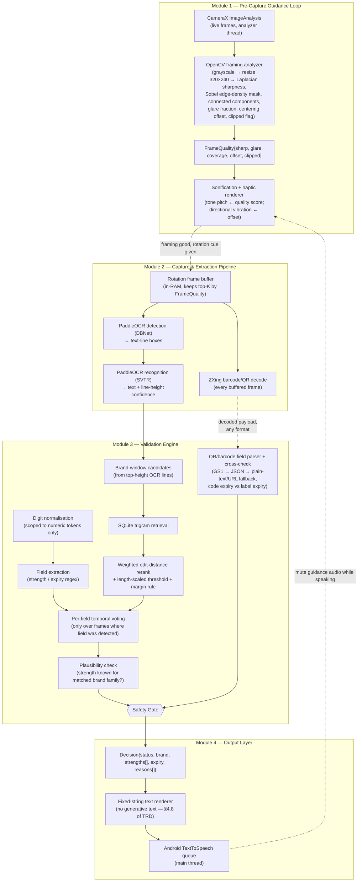
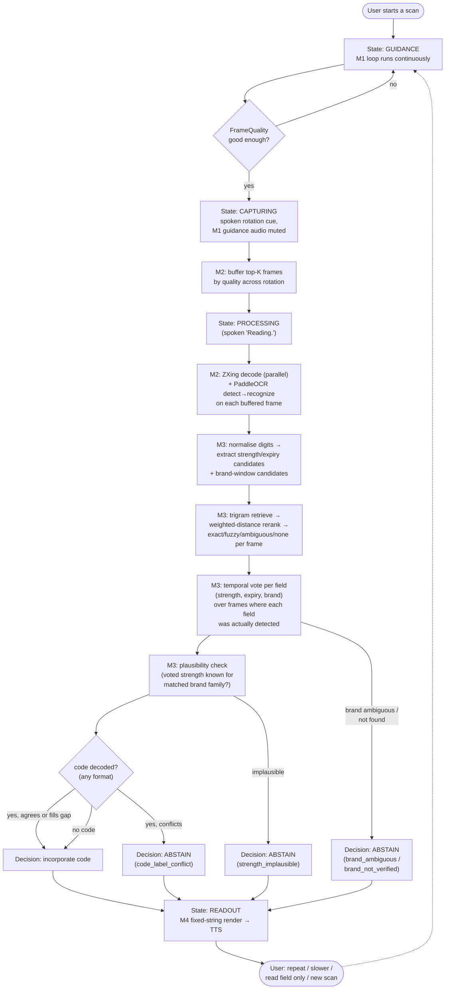

# System Architecture Document

**Companion docs:** PRD (01) · TRD (02) · Database Design (04) · Frontend/Accessibility UX (05)

---

## 1. Overview

The app has four modules, each with a single responsibility, connected by plain data classes rather than shared mutable state. This mirrors the reference implementation's separation between framing analysis (not yet built in Kotlin), field extraction/voting/matching (`label_logic.py`, fully tested), and rendering (`render_text`) — the Kotlin port should preserve that boundary so the safety-critical logic in Module 3 stays unit-testable without a camera, a device, or Android framework classes.

---

## 2. Module Detail

### 2.1 Pre-Capture Guidance Loop
**Responsibility:** tell the user, non-visually, how to position the pack — before any frame is used for reading.

- Runs continuously on the CameraX `ImageAnalysis` executor thread while the app is in **Guidance state** (see UX doc's state machine).
- Every analyzed frame is downscaled (reference prototype: 320×240) and scored for sharpness (Laplacian variance), glare (fraction of near-white pixels), edge-density-based label region and coverage/offset/clipped flags, and a centering offset relative to frame center.
- The renderer maps this `FrameQuality` to a continuous audio tone (pitch rises as the combined score improves) and directional haptic pulses (left/right/up/down) — never to speech, so it never competes with TTS.
- **Never writes a frame to storage.** Frames exist only as in-memory buffers for scoring.
- When quality crosses a "good enough to start capture" threshold, the loop hands off to Module 2 and switches to a spoken rotation cue ("slowly turn the pack to your right").

### 2.2 Capture & Extraction Pipeline
**Responsibility:** turn a short rotation capture into raw text and any decodable machine-readable code.

- `BUFFER` retains references to only the top-K frames by quality score across the rotation (proposed K=6-8; tune after OCR latency is measured per TRD §3), not every captured frame — this is what keeps the 0.5-2 s/frame OCR cost from being paid dozens of times.
- `ZX` (ZXing) runs on every buffered frame independently of OCR — a decoded payload doesn't require or wait for OCR to finish. The payload's *format* isn't assumed: CDSCO's Schedule H2 QR mandate doesn't enforce the GS1 element-string standard, so domestic labels may carry a GS1 string, a proprietary JSON object, or a plain-text/URL payload. `GS1` in this diagram is shorthand for the field parser that tries all three (TRD §4.7) — it is not a GS1-only component.
- OCR runs in two stages per PaddleOCR's architecture: detection (DBNet) locates text-line boxes, recognition (SVTR) reads each box. Line **height** is retained and passed downstream — Module 3 uses it as a rough proxy for "this is probably the brand name printed largest on the label" (see `brand_windows()` in the reference implementation, which sorts candidate lines by height before generating brand-name windows).
- All of Module 2 runs off the main thread on a background executor/coroutine scope.

### 2.3 Validation Engine
**Responsibility:** the safety-critical core. Turns raw, error-prone OCR text into either a verified spoken fact or an honest abstention. Fully specified in TRD §4; this section covers only the data flow and threading.

- Pure business logic, framework-agnostic by design (matching the reference `label_logic.py`, which imports nothing Android- or OpenCV-specific). This is what makes it unit-testable on the JVM without an emulator, and it's the module the 26-case test suite in TRD §4.9 targets.
- Reads: `List<FrameText>` (one per buffered frame, from Module 2) and any decoded QR/barcode fields (expiry, batch), regardless of which payload format they were parsed from.
- Writes: a single `Decision` object — status (`FULL` / `PARTIAL` / `ABSTAIN`), the fields it verified, and the reasons for anything it didn't.
- Runs on the same background executor as Module 2; the whole Capture→Validate pipeline for one scan is one background unit of work that posts a single `Decision` back to the UI/ViewModel thread.
- SQLite access (trigram retrieval + rerank) happens inside this module, off the main thread — see Database Design doc §5 for the retrieval-path detail and measured timings.

### 2.4 Output Layer
**Responsibility:** speak the `Decision`, and only the `Decision` — never re-derive or embellish it.

- `TEXTGEN` maps a `Decision` to spoken text using **fixed strings** for every abstention/flag reason (TRD §4.8) and a deterministic template for the verified-fields case (brand → strength(s) → expiry status), with numbers spelled digit-by-digit (TRD §5). There is no free-text generation step anywhere in this layer — this is a deliberate architectural constraint, not just a style choice, because it removes an entire class of hallucination risk from the one place the user actually hears something.
- `TTSQ` is Android's native `TextToSpeech`, queued on the main thread. Guidance audio (Module 1) is explicitly muted while `TTSQ` is speaking, and vice versa, enforced by the state machine (UX doc §3) rather than left to chance.

---

## 3. Data Flow — Full Pipeline (camera open → audio output)

This is the same decision tree as the PRD's user-facing flowchart (§6), expanded to show which module owns each decision point and where the safety gate's abstention branches actually originate in the code (TRD §4.3-§4.7).

---

## 4. Threading Model

| Thread/executor | Owns | Never does |
|---|---|---|
| CameraX analyzer executor | Module 1 (OpenCV framing analysis), continuously during Guidance state | OCR, DB access, TTS calls |
| Background executor/coroutine scope | Module 2 (buffering, ZXing, PaddleOCR) and Module 3 (extraction, voting, SQLite, gate) for one scan | Any UI mutation directly — posts a `Decision` back to the main thread |
| Main/UI thread | ViewModel state transitions, `TextToSpeech` invocation, TalkBack-facing UI updates | Any OpenCV/OCR/SQLite call — keeps the UI thread free so TalkBack stays responsive throughout |

Rationale for keeping SQLite access off the main thread even though the desktop-measured retrieval time is well under a frame budget (TRD §3): this is directional desktop evidence, not a device measurement (TRD-OQ5), and blocking the main thread is the one mistake that would make the accessibility experience (TalkBack responsiveness) fail regardless of how fast the query turns out to be.

---

## 5. What This Architecture Deliberately Does Not Have

Per the PRD's non-goals and your scope preferences:

- No network layer, no server, no sync — every module above is fully local.
- No auth module, no user accounts, no analytics/telemetry pipeline.
- No generative text-composition step in the Output Layer (§2.4) — this is a safety property, not a missing feature.
- No dependency from Module 1 or Module 2 into Module 3's internals — they only ever hand off plain data (`FrameQuality`, `FrameText`, decoded QR/barcode fields), which is what lets Module 3 be built and tested as ordinary Kotlin before any camera or OpenCV integration exists.
