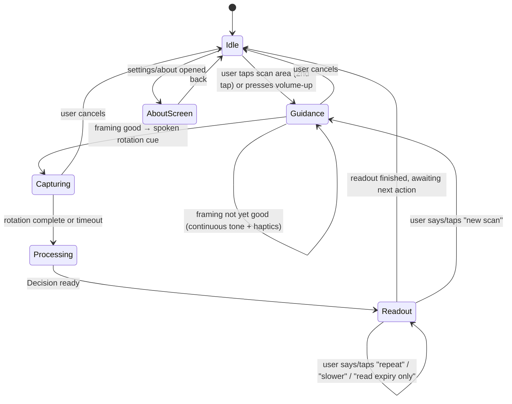

# Frontend Design and Accessibility UX Document

**Companion docs:** PRD (01) · TRD (02) · System Architecture (03) · Database Design (04)
**Standard:** WCAG 2.2 Level AA, applied through Android's native accessibility model (TalkBack), not the web ARIA model — see the correction in §2.

---

## 1. Platform Correction: ARIA vs Android Semantics

Your Prompt 5 asked for "ARIA/TalkBack roles". ARIA (`role`, `aria-label`, etc.) is a **web** standard for HTML; it has no meaning in a native Android view tree. The Android-native equivalents that actually drive TalkBack are:

| Web/ARIA concept | Android-native equivalent |
|---|---|
| `aria-label` | `contentDescription` (View) / `Modifier.semantics { contentDescription = ... }` (Compose) |
| `role="button"` | Native `Button`/`ImageButton` (role is implicit) or `Modifier.semantics { role = Role.Button }` in Compose |
| `aria-live` region | `View.announceForAccessibility()` or a Compose `LiveRegion` semantics property |
| WCAG 2.5.8 (24×24 **CSS pixel** minimum target) | This is a web success criterion measured in CSS px. On Android the equivalent practice is `dp`-based touch target sizing per Android's own accessibility guidance — **48dp minimum**, which this project already exceeds the letter of 2.5.8 by design (per your Prompt 5). Use `dp`, not `px`, throughout. |

Everything below uses the Android-native vocabulary.

---

## 2. Design Principles for This User Base

1. **One primary action, always in the same place.** No menu to search for, no icon grid to interpret by touch.
2. **State is announced, not shown.** Every transition speaks or sonifies a change; nothing relies on the user seeing a visual indicator.
3. **Guidance and readout never overlap.** Continuous framing audio and spoken results compete for the same channel (the ear) — the state machine (§4) enforces mutual exclusion.
4. **Touch exploration must be safe.** A blind user commonly drags a finger across the screen to discover what's there (explore-by-touch). Every element that finger passes over must announce something sensible, and nothing should trigger destructively from a single touch.
5. **The DB/validation engine's caution is reflected in the UI's caution.** An abstention is not an error state to apologize for — it's the app doing its job correctly (per TRD §4). The UI must not make abstention feel like failure.

---

## 3. Screen Structure

**Keep it to three screens total for the MVP**, all reachable without hunting:

| Screen | Purpose | Default state on open |
|---|---|---|
| **Scan** (home) | The entire app, functionally | GUIDANCE (see §4) |
| **Settings** | Language, haptics/audio toggle, speech rate | Not entered during a scan flow |
| **About/Disclaimer** | First-run onboarding + always-available "what this app does and doesn't do" | Shown once automatically (J0 in PRD §6), reachable anytime after |

### Scan screen layout

A single full-bleed touch target fills the screen — not a small button in the middle of empty space:

```
┌─────────────────────────────────────┐
│                                       │
│                                       │
│        (entire screen is the         │
│         scan control — no visual     │
│         chrome required to use it)   │
│                                       │
│                                       │
│  ┌─────────────────────────────┐    │
│  │  ⓘ  Settings   (48dp target,  │    │  ← small, corner-anchored,
│  │     bottom-right corner)      │    │     never in the main sweep path
│  └─────────────────────────────┘    │
└─────────────────────────────────────┘
```

**Why full-screen, and how it actually works with TalkBack:** with TalkBack on, a single tap moves accessibility focus to whatever was touched; a *second* tap (anywhere on screen, not necessarily the same spot) activates the currently focused element. Because the scan area is the only large interactive element on the screen, a user's first touch focuses it and announces its label; a second tap starts the scan. This is the standard accessible pattern for "the one big button" apps — it is not the same as a sighted single-tap-to-activate flow, and onboarding (J0) must say this explicitly rather than assume it's discovered.

**Hardware key alternative (required, not optional):** relying only on a screen tap is fragile for a user who is also holding a pill bottle in one hand. Bind scan-start to the **volume-up** hardware key as well (a widely used accessible-app convention), consumed only while the Scan screen is foregrounded so it doesn't interfere with system volume elsewhere. Document this in onboarding and in Settings.

---

## 4. Interface State Machine



| State | What's audible | What's NOT audible | contentDescription of the scan area |
|---|---|---|---|
| **Idle** | Nothing (silence, waiting) | — | "Scan a medicine. Double-tap or press volume up to begin." |
| **Guidance** | Continuous sonification tone (pitch = framing quality) + directional haptics + occasional short spoken hints ("too much glare, tilt slightly") | TTS readout, previous scan's result | "Guiding. Hold the medicine steady." (live-region updates as hints occur) |
| **Capturing** | Spoken rotation progress cues only; guidance tone stops | Guidance tone/haptics (avoid double signal during the deliberate rotation) | "Capturing. Keep turning slowly." |
| **Processing** | Single short spoken "Reading." then silence until done | Everything else | "Reading the label." (announced once, not repeated) |
| **Readout** | Structured TTS result (TRD §5) or abstention text (TRD §4.8) | Guidance tone | Full spoken result is pushed via `announceForAccessibility` / live region, not just set as a static label, so TalkBack users hear it immediately without needing to re-focus anything |

This mutual-exclusion rule (guidance audio vs. TTS) is enforced by the ViewModel that owns this state machine (Architecture doc §2.4), not left as a UI-layer convention — a stray guidance tone playing under the spoken result is exactly the "sensory dissonance" the original research flagged as a usability failure.

---

## 5. Touch Targets

| Element | Minimum size | Rationale |
|---|---|---|
| Scan area | Full screen | Not a target-size concern — it's everything |
| Settings icon | **48dp × 48dp** minimum, generous padding around it | Exceeds WCAG 2.5.8's 24×24 CSS-px web minimum by design (your Prompt 5 requirement); 48dp is Android's own recommended minimum and gives real margin for tremor or imprecise touch-exploration, which the original research specifically flagged as a usability factor for this population |
| Any toggle/slider in Settings | 48dp × 48dp per control, minimum 8dp spacing between adjacent controls | Prevents accidental adjacent-control activation during touch exploration |
| "Repeat" / "new scan" spoken commands | N/A — voice command, no touch target | Primary interaction path in Readout state; touch equivalents (large full-screen taps mapped to the same actions) are a fallback, not the primary path |

Never place two touch targets closer than 8dp apart, and never rely on precise tap location distinguishing two nearby controls — this population's interaction model is explore-then-activate, not point-and-tap.

---

## 6. Semantic Labeling Reference

| UI element | `contentDescription` (English; localize per language setting) | Live region? |
|---|---|---|
| Scan area, Idle | "Scan a medicine. Double-tap or press volume up to begin." | No |
| Scan area, Guidance | "Guiding. Hold the medicine steady." + hint text as it changes | **Yes** — polite live region, so hint changes are announced without stealing focus |
| Scan area, Capturing | "Capturing. Keep turning slowly." | Yes |
| Scan area, Processing | "Reading the label." | Yes, announced once |
| Scan area, Readout | Full rendered result string (TRD §4.8/§5) | **Yes — assertive**, since this is the entire point of the interaction and must not be missed |
| Settings icon | "Settings. Language, sound, and speech rate." | No |
| Language selector (Settings) | "Language. Currently English. Double-tap to change." | No |
| Haptics/audio toggle (Settings) | "Guidance feedback. Currently audio and vibration." | No |
| About/disclaimer entry | "About this app. This app assists reading medicine labels. It is not a substitute for a pharmacist or doctor." | No |

Every one of these strings ships pre-recorded/pre-templated per the Output Layer's fixed-string design (TRD §4.8, Architecture §2.4) — none are composed dynamically beyond simple field substitution (e.g. inserting the read brand/strength/expiry into the Readout template), which keeps localization tractable and keeps the "no generative text in the safety-critical path" property intact for the UI layer too.

---

## 7. Visual Design (for the sighted low-vision persona, P2 in the PRD)

Even though the primary interaction is non-visual, Persona P2 (older adult, low vision, less familiar with screen readers) needs a usable visual layer too:

| Requirement | Value |
|---|---|
| Minimum contrast, standard text | 4.5:1 (WCAG 2.2 AA) |
| Minimum contrast, large text (≥18pt or ≥14pt bold) | 3:1 |
| Text scaling | Must respect the system font-size setting (`sp` units, never hardcoded `dp` for text); layout must not clip or truncate at the largest system scale |
| Color as sole indicator | Never — every state change (Guidance/Capturing/Processing/Readout) is also conveyed by text label and audio, not color alone |
| Motion | No flashing content; state-change animations, if any, are simple crossfades, never rapid flicker |
| Dark/light | Support both, driven by system setting, high-contrast palette in both |

---

## 8. Usability Validation Plan (ties to PRD §9)

- **Automated pass first:** Android Accessibility Scanner + a TalkBack walkthrough of all three screens and all five states in §4, checking every element in §6 announces correctly and every target in §5 measures out.
- **Manual pass, required, not optional:** at minimum, eyes-closed testing by the team performing a full scan unaided by sight — this is the only way to validate that the sonification/haptic guidance (Module 1, Architecture doc) is actually sufficient without visual fallback, since a sighted tester watching the screen doesn't exercise the feature under test.
- **Strongest evidence:** a short session with NAB or XRCVC participants (per the original field-research context), scored with the System Usability Scale, if a session can be arranged before the demo (PRD Open Question 5).
- **What "done" looks like for this document:** zero blocking issues in the automated scan, a completed eyes-closed team walkthrough, and every `contentDescription` in §6 verified against the actual TalkBack announcement on-device (strings drift from spec during implementation more often than logic does).
