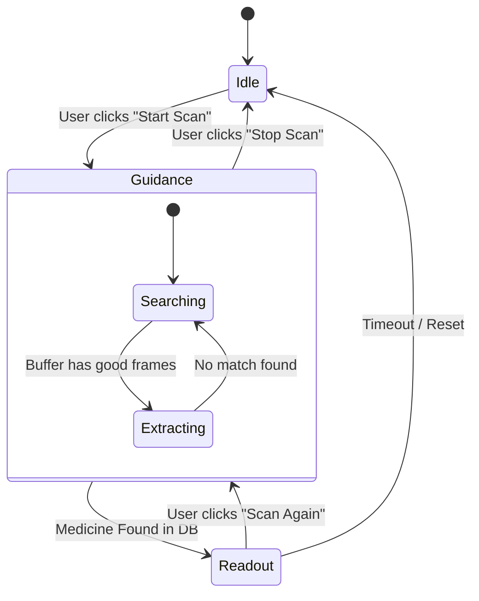
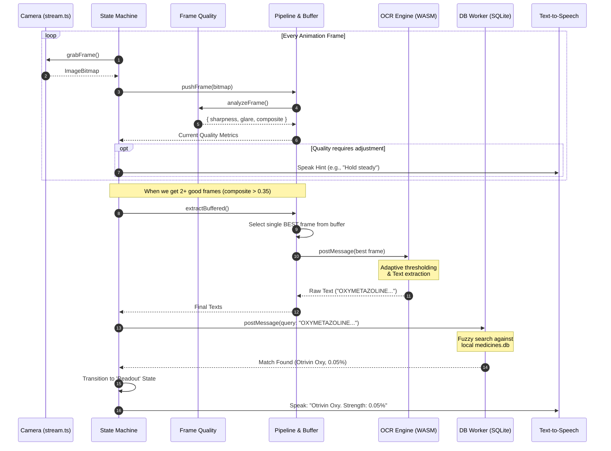

# EchoSight: System Architecture and Data Flow

EchoSight is a privacy-first, offline-capable Progressive Web App (PWA) designed to help visually impaired users read medicine labels. It runs entirely on the client side using WebAssembly (WASM) for computer vision and database queries.

## 1. Core Components

The system is organized into several distinct modules to separate camera handling, background processing, and user guidance.

### 🎥 Camera & Vision Pipeline (`src/camera/`)
*   **`stream.ts`**: Manages the device camera via `getUserMedia()`. Grabs raw frames as memory-efficient `ImageBitmap` objects.
*   **`frame-quality.ts`**: Calculates real-time heuristics for every frame. It converts the image to grayscale and uses a Laplacian variance kernel to detect:
    *   **Sharpness** (blur detection)
    *   **Glare** (overexposed pixels)
    *   **Coverage / Centering** (where text edges are located)
*   **`buffer.ts`**: A rolling buffer that holds the top 6 highest-quality frames recently seen.
*   **`pipeline.ts`**: Orchestrates the extraction. It takes the single best frame from the buffer and sends it to the OCR engine.

### 🧠 Background Workers (`src/workers/`)
*   **OCR Worker (Tesseract.js)**: Runs in a separate thread via WebAssembly. It takes a pre-processed frame, applies adaptive thresholding, and returns recognized text. It is constrained to a single thread to save memory.
*   **Database Worker (`db.worker.ts`)**: Loads a local SQLite database (`medicines.db`) into memory using `sql.js`. It runs asynchronously so that querying tens of thousands of drugs doesn't freeze the UI.

### 🗣️ Guidance & Accessibility (`src/guidance/` & `src/speech/`)
*   **`hints.ts`**: Translates frame quality metrics into spoken instructions (e.g., "Move closer", "Too much glare", "Hold steady").
*   **`sonification.ts`**: Provides continuous audio feedback (beeps/buzzes) based on frame quality, helping completely blind users center the camera on the label.
*   **`tts-manager.ts`**: Manages Text-to-Speech using the Web Speech API, handling polite interruptions and assertive announcements.

### 🧬 Label Logic (`src/core/label-logic.ts`)
*   A highly advanced text processing engine. When OCR returns messy text, this module uses fuzzy matching, trigram analysis, and Levenshtein distance to confidently match the raw text to a known brand family and extract dosages/expiries.

---

## 2. State Machine Flow

The entire application is controlled by `StateMachine` (`src/ui/state-machine.ts`), which loops through three main states.

1.  **Idle**: Camera is off, workers are asleep or terminated to save memory.
2.  **Guidance**: Camera is active. The app continuously analyzes frames, plays sonification audio, and speaks directional hints.
3.  **Readout**: Camera stops. The app displays the result on screen and uses Text-to-Speech to read the brand name, strength, and expiry date.

---

## 3. The Scan Cycle (Data Flow)

Here is exactly what happens under the hood when a user points their camera at a medicine bottle.

### Key Optimizations (Recently Applied):
1.  **Memory Management**: The DB Worker is instantiated *once* per scan session instead of once per frame. Both the DB Worker and OCR Worker are destroyed when returning to `Idle`, preventing gigabytes of memory leaks.
2.  **Resource Throttling**: Instead of throwing every frame at the OCR engine (which crashes the browser), the `FrameBuffer` collects frames, sorts them by sharpness/clarity, and only sends the absolute *best* single frame for text extraction.
3.  **Adaptive Thresholds**: Frame quality thresholds are tuned specifically for medicine labels, which have sparse text edges compared to normal photographs.
