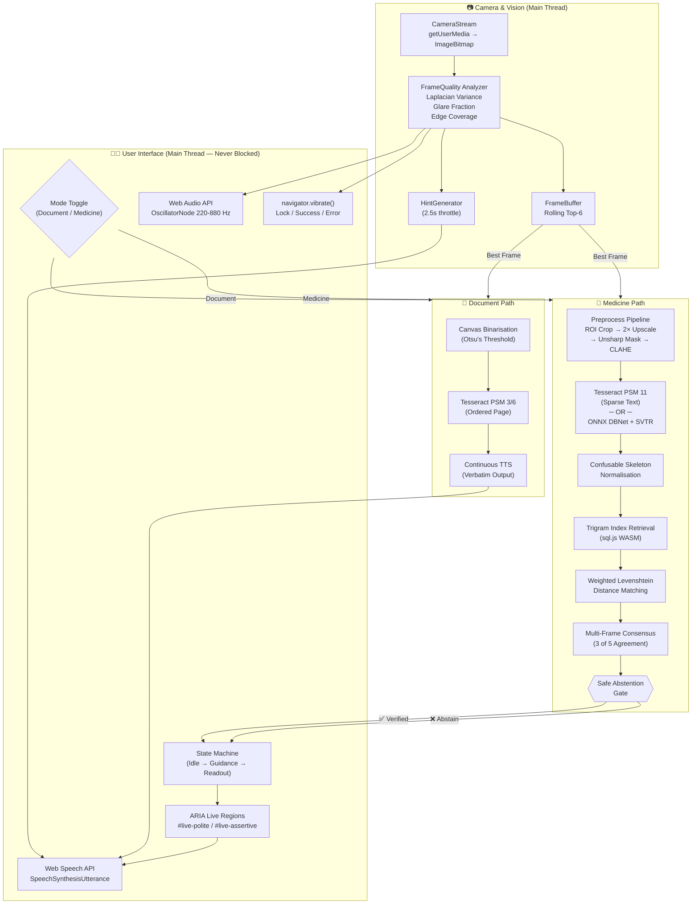
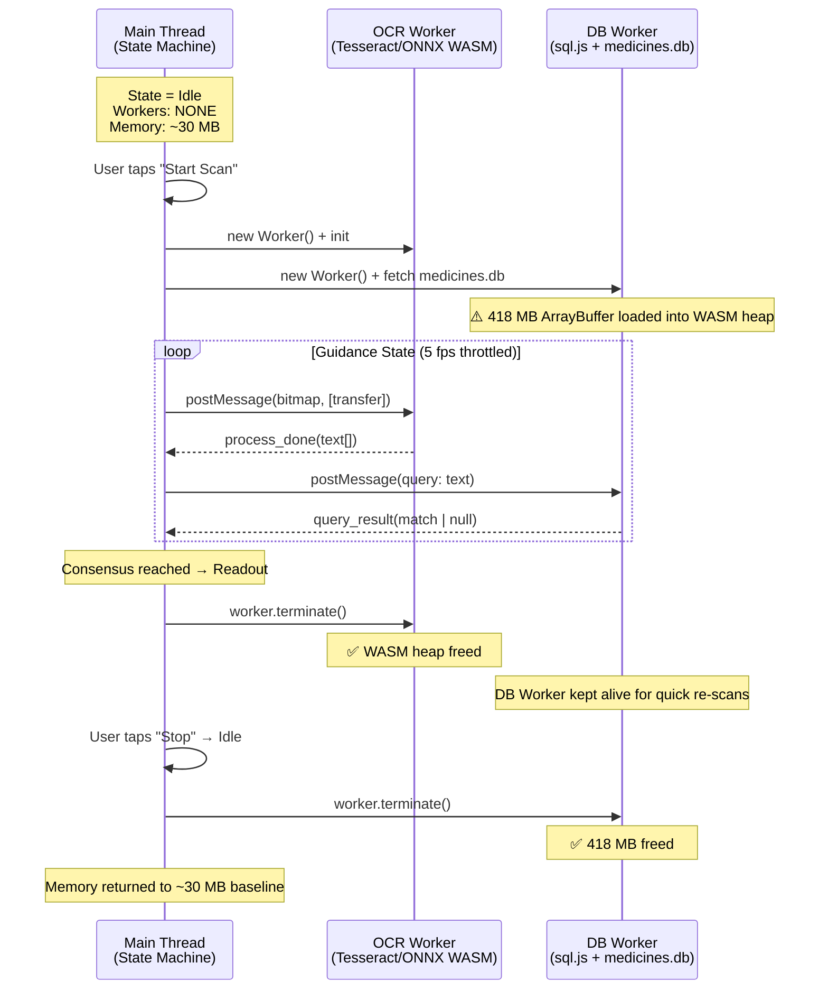

# Master Project Blueprint & Engineering Action Document

**Project Title:** OCR-Based Accessible Document and Medicine Label Reader with Audio Output
**Institution:** Vidyalankar School of Information Technology (VSIT)
**Project Type:** Community Engagement Project (CEP) — Final Year
**Working Product Name:** EchoSight
**Platform:** Progressive Web App (PWA) — 100% Offline, Client-Side
**Version:** 0.2 (Historical planning document; verify implementation details against the current source and README)

---

> [!IMPORTANT]
> This document is the authoritative engineering reference for the EchoSight project. It merges a full static analysis of the existing codebase with a peer-reviewed research dossier to produce actionable specifications across architecture, datasets, engineering tasks, evaluation methodology, academic citations, and institutional chapter mapping.

---

## Table of Contents

1. [Section 1: System Evolution & Dual-Engine Blueprint](#section-1-system-evolution--dual-engine-blueprint)
2. [Section 2: Datasets, Pharmaceutical Registries & Benchmark Suites](#section-2-datasets-pharmaceutical-registries--benchmark-suites)
3. [Section 3: Engineering Roadmap & Code Modifications](#section-3-engineering-roadmap--code-modifications)
4. [Section 4: Empirical Evaluation & Experimental Setup](#section-4-empirical-evaluation--experimental-setup)
5. [Section 5: Academic References & Literature Dossier](#section-5-academic-references--literature-dossier)
6. [Section 6: Institutional Report Mapping (VSIT CEP Chapters 1–8)](#section-6-institutional-report-mapping-vsit-cep-chapters-18)

---

## Section 1: System Evolution & Dual-Engine Blueprint

### 1.1 Current Codebase Analysis

The existing EchoSight repository is a Vite-based TypeScript Progressive Web App. The following table summarises the implemented modules as they exist in the current workspace:

| Module | Location | Status | Key Responsibility |
|:--|:--|:--|:--|
| Camera Stream | `src/camera/stream.ts` | ✅ Implemented | `getUserMedia()` acquisition of raw `ImageBitmap` frames |
| Frame Quality Analyzer | `src/camera/frame-quality.ts` | ✅ Implemented | Laplacian variance blur detection, glare fraction, edge-density coverage, centering offset. Analysis resolution: 320×240. |
| Frame Buffer | `src/camera/buffer.ts` | ✅ Implemented | Rolling top-K buffer (K=6) sorted by composite quality score |
| Image Preprocessing | `src/camera/preprocess.ts` | ✅ Implemented | ROI cropping (centre 60%), 2× upscale, 3×3 unsharp mask convolution, full CLAHE with bilinear tile interpolation |
| Barcode Scanner | `src/camera/barcode.ts` | ✅ Scaffolded | `BarcodeDetector` API integration for QR/barcode fallback |
| Extraction Pipeline | `src/camera/pipeline.ts` | ✅ Implemented | Orchestrator: selects best frame and runs adaptive Tesseract recognition |
| OCR Worker (Tesseract) | `src/camera/pipeline.ts` (`RealOcrWorker`) | ✅ Implemented | Tesseract.js v7 WASM, PSM 11 (Sparse Text), inline within pipeline module |
| DB Worker (SQLite) | `src/workers/db.worker.ts` | ✅ Implemented | `sql.js` WASM loads the provenance-tracked official catalogue; trigram retrieval + weighted Levenshtein matching |
| Label Logic Engine | `src/core/label-logic.ts` | ✅ Implemented | Confusable skeleton normalisation, trigram codes, field extraction (strength regex, expiry regex), multi-frame temporal voting, safe abstention gate |
| Sonification Engine | `src/guidance/sonification.ts` | ✅ Implemented | `AudioContext` → `OscillatorNode` (220–880 Hz) → `StereoPannerNode` → `GainNode`, maps composite score to pitch |
| Hint Generator | `src/guidance/hints.ts` | ✅ Implemented | Throttled spoken hints (2.5 s cooldown): glare, coverage, centering, sharpness |
| Haptic Vibration | `src/guidance/vibration.ts` | ✅ Implemented | `navigator.vibrate()` patterns: lock (50 ms), success (100 ms), error (50-100-50 ms) |
| TTS Manager | `src/speech/tts-manager.ts` | ✅ Implemented | Dual-mode: native `SpeechSynthesis` (desktop) or ARIA live-region injection (TalkBack mode) |
| ARIA Announcer | `src/speech/aria-announcer.ts` | ✅ Implemented | Injects text into `#live-polite` and `#live-assertive` DOM regions |
| State Machine | `src/ui/state-machine.ts` | ✅ Implemented | Three states: `Idle` → `Guidance` → `Readout`. Multi-frame consensus (3/5 agreement). Memory lifecycle management. |
| Settings Screen | `src/ui/settings.ts` | ✅ Scaffolded | TalkBack toggle, speech rate, language selection |
| Service Worker | `public/sw.js` | ✅ Implemented | Shell precache plus same-origin runtime caching after first complete load |
| Evaluation Runner | `scripts/evaluate.ts` | ✅ Implemented | CER/WER benchmark that fails when no real frames are available |

### 1.2 The Dual-Engine Blueprint: Document Mode vs. Medicine Mode

The project supports medicine labels and medical reports through one automatic scanner. The pipeline chooses sparse-label or full-page OCR behavior from scan evidence; the user does not need to select a mode.

#### Module 1: Document Reader Mode

**Target:** Flat academic papers, worksheets, notices, printed circulars.

| Stage | Technique | Rationale |
|:--|:--|:--|
| **Pre-processing** | Otsu's Global Thresholding (canvas binarisation) | Flat documents have uniform lighting; a single global threshold cleanly separates black text from white paper. CLAHE is unnecessary and computationally wasteful for this use case. |
| **Tesseract PSM** | PSM 3 (Fully automatic page segmentation) or PSM 6 (Assume a single uniform block of text) | Documents have predictable horizontal baselines, paragraph structure, and reading order. PSM 3/6 preserves this reading order, which is critical for coherent TTS output. |
| **TTS Output** | Continuous streaming TTS | The entire recognised text block is spoken sequentially, paragraph by paragraph, without interruption. The user can pause/resume. |
| **Database Verification** | **Bypassed entirely** | There is no pharmaceutical safety concern. The OCR output is spoken verbatim. No trigram index lookup, no Levenshtein matching, no safe abstention gate. This dramatically reduces latency and memory usage since the 418 MB `medicines.db` is never loaded. |
| **Memory Profile** | ~50–80 MB WASM (Tesseract only) | The DB Worker (`db.worker.ts`) is never instantiated. Only a single Tesseract worker is created. |

#### Module 2: Medicine Label Reader Mode

**Target:** Curved cylindrical bottles, glossy blister packs, foil wrappers, inkjet-stamped expiry codes.

| Stage | Technique | Codebase Location |
|:--|:--|:--|
| **Blur Rejection** | Laplacian 3×3 kernel variance; threshold < 50 = discard | `src/camera/frame-quality.ts` L62–L101 |
| **Glare Detection** | Fraction of pixels where R > 240 ∧ G > 240 ∧ B > 240 | `src/camera/frame-quality.ts` L53–L56 |
| **ROI Cropping** | Centre 60% crop via `createImageBitmap()` zero-copy | `src/camera/preprocess.ts` L13–L24 |
| **2× High-Quality Upscale** | Canvas `drawImage()` with `imageSmoothingQuality: 'high'` | `src/camera/pipeline.ts` L44–L51 |
| **Sharpening** | 3×3 unsharp mask kernel `[0,-1,0,-1,5,-1,0,-1,0]` | `src/camera/preprocess.ts` L35–L86 |
| **Contrast Enhancement** | CLAHE (8×8 tile grid, clip limit 3.0, bilinear interpolation) | `src/camera/preprocess.ts` L99–L236 |
| **Tesseract PSM** | PSM 11 (Sparse text — find as much text as possible in no particular order) | `src/camera/pipeline.ts` L22–L24 |
| **OCR Pipeline** | Adaptive Tesseract recognition with medicine-specific preprocessing and a full-page report pass | `src/camera/pipeline.ts` |
| **Confusable Skeletons** | `0→O, 1→I, L→I, 5→S, 8→B, 2→Z, 6→G, V→U, RN→M` | `src/core/label-logic.ts` L31–L33, `src/workers/db.worker.ts` L9–L11 |
| **Trigram Inverted Index** | Base-37 trigram codes → SQLite `name_trigrams` table → Jaccard candidate retrieval | `src/workers/db.worker.ts` L35–L45, `schema.sql` L59–L64 |
| **Weighted Levenshtein** | Confusable pairs cost 0.25 (not 1.0); length-scaled threshold: ≤4 chars → 0.5, ≤7 → 1.0, else → 1.5 | `src/workers/db.worker.ts` L47–L65 |
| **Multi-Frame Consensus** | Rolling window of 5 reads; brand name must agree in ≥3 of 5 frames | `src/ui/state-machine.ts` L87–L121 |
| **Safe Abstention Gate** | If consensus fails after N extraction cycles, the system announces "Unable to verify. Please seek human assistance." and refuses to guess. | `src/ui/state-machine.ts` (to be hardened; currently silent non-consensus) |

### 1.3 Dual-Engine Architectural Pipeline Diagram



> [!NOTE]
> **Critical architectural constraint:** All WASM-heavy computation (Tesseract inference, SQLite queries) executes inside dedicated Web Workers via `postMessage()` / `onmessage` to guarantee the main thread's event loop — and therefore the screen reader's accessibility API hooks — remain completely unblocked at all times.

### 1.4 Web Worker Memory Lifecycle



---

## Section 2: Datasets, Pharmaceutical Registries & Benchmark Suites

### 2.1 External Datasets & Registries

#### 2.1.1 Printed Text & Document OCR Datasets

| Dataset | Description | Use Case | Access |
|:--|:--|:--|:--|
| **ICDAR 2013/2015/2019** | International Conference on Document Analysis and Recognition benchmark datasets. Contain labelled images of printed text in structured documents and scene text. | Baseline CER/WER benchmarking for Document Reader Mode (PSM 3/6). Scene text subsets useful for curved-text evaluation. | [icdar.org](https://rrc.cvc.uab.es/) |
| **PubLayNet** | 360K+ document images with labelled layout regions (text, title, list, table, figure) derived from PubMed Central. | Training/evaluating document layout segmentation if future versions add layout-aware reading order. | [GitHub](https://github.com/ibm-aur-nlp/PubLayNet) |
| **TextOCR** | 900K+ annotated text instances in natural images from Open Images. | Scene text recognition benchmarking for Medicine Mode. | [textvqa.org](https://textvqa.org/textocr/) |

#### 2.1.2 Pharmaceutical Packaging Datasets

| Dataset | Description | Use Case | Access |
|:--|:--|:--|:--|
| **GroZi-120** | 120 grocery product categories with in-vitro (flat) and in-situ (shelf/hand) images. Includes curved, glossy, and partially occluded packaging. | Closest public proxy for medicine bottle curvature and specular reflection. | [UCSD Vision Lab](http://grozi.calit2.net/) |
| **Roboflow / Kaggle Blister Pack Datasets** | Community-contributed annotated images of pharmaceutical blister packs with bounding boxes for tablet windows, text regions, and foil surfaces. | Evaluating glare rejection and embossed text detection under controlled conditions. | Search Roboflow Universe / Kaggle |
| **MVTec Anomaly Detection (Capsule/Pill subset)** | High-resolution industrial images of pharmaceutical capsules/pills with defect annotations. | Not directly OCR-relevant, but useful for validating frame quality heuristics on pharmaceutical surfaces. | [MVTec AD](https://www.mvtec.com/company/research/datasets/mvtec-ad) |

#### 2.1.3 Indian Pharmaceutical Database for `medicines.db`

| Source | Description | Schema Alignment |
|:--|:--|:--|
| **Mankind Pharma official product list** | Manufacturer-published brand and molecule catalogue, captured with retrieval timestamp and source checksum. | **Current source.** `scripts/fetch-official-medicines.mjs` creates the provenance snapshot consumed by `scripts/build-db.cjs`. |
| **CDSCO (Central Drugs Standard Control Organisation)** | India's national regulatory authority. Publishes approved drug lists, but not in machine-readable bulk format. | **Supplementary.** Manual cross-referencing for validation of brand family completeness. |
| **National List of Essential Medicines (NLEM) 2022** | Government of India's curated list of ~384 essential medicines. | **Supplementary.** Can be used to prioritise brand families in the trigram index for faster retrieval of commonly encountered drugs. |

**ETL Pipeline (Existing):**

The `scripts/build-db.cjs` script already implements the following transformation:

```
medicines.csv (354 MB)
    │
    ▼
┌─────────────────────┐
│  Parse CSV rows      │
│  Normalize names     │
│  Extract brand       │
│    families          │
│  Compute skeletons   │
│  Generate trigrams   │
│  Canonicalize        │
│    strengths         │
└─────────┬───────────┘
          │
          ▼
    medicines.db (418 MB SQLite)
    ├── manufacturers
    ├── generics
    ├── brand_families
    ├── brand_names (with skeleton column)
    ├── medicines
    ├── medicine_ingredients (strength_canon)
    ├── family_strengths (plausibility)
    └── name_trigrams (inverted index)
```

### 2.2 The "Golden Dataset" Protocol

#### 2.2.1 Curation Methodology (100 Samples)

**Stratum A: Academic Documents (50 samples)**

| ID Range | Category | Specification | Count |
|:--|:--|:--|:--|
| DOC-001 to DOC-010 | Clean printed A4 | 12pt serif/sans-serif, white paper, good lighting | 10 |
| DOC-011 to DOC-020 | Notice board circulars | Pinned/wrinkled paper, mixed fonts, partial shadows | 10 |
| DOC-021 to DOC-030 | Worksheets/forms | Tables, checkboxes, handwritten annotations mixed with print | 10 |
| DOC-031 to DOC-040 | Low-light captures | Same documents as DOC-001–010, captured under dim indoor lighting (< 200 lux) | 10 |
| DOC-041 to DOC-050 | Skewed/rotated | Same documents captured at 10–30° rotation angles | 10 |

**Stratum B: Pharmaceutical Packaging (50 samples)**

| ID Range | Category | Specification | Count |
|:--|:--|:--|:--|
| MED-001 to MED-010 | Flat cardboard boxes | Common Indian OTC medicines (Crocin, Dolo, Combiflam), clear print, good lighting | 10 |
| MED-011 to MED-020 | Cylindrical bottles | Nasal sprays (Otrivin), syrups, eye drops — curved text baselines | 10 |
| MED-021 to MED-030 | Foil blister packs | Aluminium backing with embossed/stamped batch and expiry codes, specular glare | 10 |
| MED-031 to MED-040 | Glare-dominant captures | Same packaging as MED-001–020, captured with flash or under direct fluorescent lighting | 10 |
| MED-041 to MED-050 | Extreme edge cases | Faded ink, partially torn labels, very small print (≤ 8pt), dual-language (English + Hindi) | 10 |

#### 2.2.2 Ground Truth Specification

Each sample consists of three files:

```
golden_dataset/
├── documents/
│   ├── DOC-001/
│   │   ├── frame.png          # Raw camera capture (unprocessed)
│   │   ├── ground_truth.txt   # Exact text content, line-by-line
│   │   └── metadata.json      # { "category": "clean_a4", "lighting": "good",
│   │                          #   "rotation_deg": 0, "distance_cm": 25 }
│   ├── DOC-002/
│   │   └── ...
│   └── ...
├── medicines/
│   ├── MED-001/
│   │   ├── frame.png
│   │   ├── ground_truth.json  # { "brand_name": "Crocin 650 Advance",
│   │   │                      #   "strength": "650 mg",
│   │   │                      #   "expiry": "11/2027",
│   │   │                      #   "manufacturer": "GSK",
│   │   │                      #   "generic": "Paracetamol" }
│   │   └── metadata.json     # { "category": "flat_box", "surface": "matte",
│   │                          #   "lighting": "good", "curvature": "none" }
│   └── ...
└── README.md                  # Dataset version, collection protocol, IRB notes
```

**Collection Protocol:**
1. Capture device: Budget Android phone (₹10–15K, 3–4 GB RAM) — matches target user hardware.
2. All frames captured via the EchoSight PWA's own `CameraStream.grabFrame()` to ensure identical sensor preprocessing.
3. Each frame is captured 3 times; the median-quality frame (by Laplacian variance) is selected as the canonical sample.
4. Ground truth text is manually transcribed by two independent annotators; disagreements resolved by a third.
5. Medicine ground truth is additionally verified against the `medicines.db` database entry.

---

## Section 3: Engineering Roadmap & Code Modifications

> [!WARNING]
> This section documents **specifications only**. No code files in the workspace are to be modified as part of this document. All entries describe the *what* and *where* of required changes for implementation reference.

### 3.1 UI & State Machine Modifications

#### 3.1.1 Mode Toggle Switch (`index.html`, `src/ui/state-machine.ts`)

**Specification:**

A new `<div id="mode-toggle">` must be inserted into `index.html` between the `<header>` and `<main>` elements:

```
Location: index.html, after line 23 (after </header>)

Required element:
- A segmented control with two options: "Document" and "Medicine"
- WCAG 2.1 AAA compliant:
  - Minimum contrast ratio: 7:1 for text against background
  - Touch target: minimum 48×48 CSS pixels
  - role="radiogroup" with two role="radio" children
  - aria-checked state management
  - aria-label="Select reading mode"
- Default mode: "Medicine" (safety-first default)
```

**State Machine Integration:**

The `StateMachine` class in `src/ui/state-machine.ts` must be extended with:
- A new property `private mode: 'document' | 'medicine' = 'medicine';`
- The `transitionTo('Guidance')` handler must branch based on `this.mode`:
  - **Document mode:** Do NOT instantiate `dbWorker`. Create `ExtractionPipeline` with `engine = 'tesseract'` and PSM override to 3.
  - **Medicine mode:** Current behaviour (instantiate both OCR and DB workers).

#### 3.1.2 High-Contrast Mode Toggle (`src/ui/settings.ts`, `src/styles/app.css`)

**Specification:**

A new toggle in the settings screen:

```
Settings → Accessibility → High Contrast Mode (ON/OFF)

CSS Implementation (src/styles/app.css):
- Add a [data-high-contrast="true"] selector on <body>
- Override all colour variables:
  - Background: #000000 (pure black)
  - Text: #FFFFFF (pure white)
  - Primary action: #FFFF00 (yellow on black, 19.6:1 contrast)
  - Error state: #FF6666 (light red on black)
  - All borders: 2px solid #FFFFFF
- Enforce minimum font-size: 18px
- All interactive elements: outline: 3px solid #FFFF00 on :focus
```

#### 3.1.3 TalkBack Accessibility Hardening

**Current implementation analysis:** The existing ARIA integration is functional but incomplete.

| Requirement | Current State | Required Modification |
|:--|:--|:--|
| Focus trapping in modals | ❌ Not implemented | `settings-screen` must trap Tab/Shift+Tab focus within the modal when visible. Add `inert` attribute to `#app-root` when modal is open. |
| Dynamic status announcements | ⚠️ Partial | `updateAria()` in `state-machine.ts` only updates `aria-label` on the trigger button. Must also inject state transition text into `#live-assertive` (e.g., "Scanning started", "Medicine identified"). |
| `aria-live` priority | ⚠️ Partial | Guidance hints correctly use `polite`. Final readout correctly uses `assertive`. However, error/abstention announcements are missing entirely. |
| Non-visual gesture support | ✅ Implemented | Bluetooth remote and keyboard Enter/Space are handled in the constructor. |

### 3.2 Off-Thread Web Workers

#### 3.2.1 Dynamic PSM Reconfiguration (`src/camera/pipeline.ts`)

**Specification:**

The `RealOcrWorker` class must accept a `psmMode` parameter:

```
Location: src/camera/pipeline.ts, RealOcrWorker class

Current (line 22-24):
  await this.worker.setParameters({
    tessedit_pageseg_mode: '11' as any,
  });

Required modification:
  Constructor signature: constructor(psm: '3' | '6' | '11' = '11')
  Store psm in instance variable.
  Apply in init():
    await this.worker.setParameters({
      tessedit_pageseg_mode: this.psm as any,
    });

  ExtractionPipeline must pass the PSM mode based on the
  current app mode ('document' → '3', 'medicine' → '11').
```

#### 3.2.2 WASM Memory Management

**Current implementation analysis:**

The existing codebase already implements critical memory management:
- `StateMachine.teardownDbWorker()` (line 139–146): Properly terminates the DB worker and nullifies references when transitioning to Idle.
- `ExtractionPipeline.destroy()` (line 215–222): Terminates the OCR worker (both `RealOcrWorker` and native `Worker`).
- Frame buffers call `bitmap.close()` on discarded frames.
- Cropped bitmaps are explicitly closed after use (`cropped.close()` at pipeline.ts L166).

**Required additional hardening:**

| Risk | Location | Mitigation |
|:--|:--|:--|
| Tesseract WASM heap not freed on `RealOcrWorker.terminate()` | `pipeline.ts` L80–85 | The current `await this.worker.terminate()` call *should* release the WASM heap. Verify in Chrome DevTools Memory tab that the ~20–50 MB Tesseract heap is reclaimed. If not, add explicit `this.worker = null;` and `gc()` hint. |
| `medicines.db` ArrayBuffer retained after DB Worker termination | `db.worker.ts` L73 | The `new Uint8Array(buf)` copies the ArrayBuffer into WASM linear memory. When `worker.terminate()` is called, the entire WASM context is destroyed. Verify the original `ArrayBuffer` from `fetch()` is also eligible for GC (it should be, since it's scoped to `initDb()`). |

### 3.3 Canvas Pre-Processing Specifications

#### 3.3.1 Otsu's Global Thresholding (Document Mode — NOT YET IMPLEMENTED)

**Specification for `src/camera/preprocess.ts`:**

A new exported function `applyOtsuThreshold()` must be added:

```
Algorithm:
1. Convert image to grayscale (luminance formula: 0.299R + 0.587G + 0.114B)
2. Compute 256-bin histogram of grayscale values
3. Iterate threshold t from 0 to 255:
   a. Compute class probabilities: ω₀(t) = Σ p(i) for i=0..t,  ω₁(t) = 1 - ω₀(t)
   b. Compute class means: μ₀(t), μ₁(t)
   c. Compute inter-class variance: σ²_B(t) = ω₀(t) · ω₁(t) · (μ₀(t) - μ₁(t))²
4. Select t* = argmax σ²_B(t)
5. Binarise: pixel < t* → 0 (black text), pixel ≥ t* → 255 (white background)
6. Write binarised image back to canvas context

Signature:
  export function applyOtsuThreshold(
    ctx: OffscreenCanvasRenderingContext2D,
    width: number,
    height: number
  ): void
```

#### 3.3.2 Laplacian Kernel (ALREADY IMPLEMENTED)

The existing implementation in `frame-quality.ts` lines 62–101 correctly applies the 3×3 discrete Laplacian kernel `[0, 1, 0, 1, -4, 1, 0, 1, 0]` and computes the variance of the response as the sharpness metric. The composite score formula at line 116 normalises sharpness to [0, 1] by dividing variance by 500 and capping at 1.0.

**Mathematical formulation implemented:**

```
Laplacian variance = (1/N) · Σ (L(x,y) - μ_L)²

where:
  L(x,y) = I(x,y-1) + I(x-1,y) + I(x+1,y) + I(x,y+1) - 4·I(x,y)
  μ_L = mean of all L(x,y) values
  N = (width - 2) × (height - 2)  [excluding border pixels]
```

### 3.4 Non-Speech Sonification & Haptics

#### 3.4.1 Sonification (ALREADY IMPLEMENTED)

The existing `SonificationEngine` in `src/guidance/sonification.ts` implements:

```
Audio Graph:
  OscillatorNode (sine wave)
    → StereoPannerNode (centering → pan: -1.0 to +1.0)
    → GainNode (mute/unmute, max volume 0.3)
    → AudioContext.destination

Frequency mapping:
  f(composite) = 220 + composite × (880 - 220)
  Range: 220 Hz (A3, poor framing) to 880 Hz (A5, perfect framing)

Smoothing:
  setTargetAtTime() with timeConstant = 50 ms to prevent audio clicks
```

**Required enhancement for Geiger-counter ticking mode:**

The current implementation uses a continuous sine tone. An alternative Geiger-counter mode should be specified for users who find continuous tones fatiguing:

```
Specification (not yet implemented):
- New property: tickMode: boolean = false
- When tickMode = true:
  - Replace continuous oscillator with periodic short bursts
  - Tick interval = 1000 ms × (1 - composite)
  - At composite = 0.0: 1 tick per second
  - At composite = 0.5: 1 tick per 500 ms
  - At composite = 0.9: 1 tick per 100 ms (rapid ticking)
  - At composite ≥ 0.95: continuous tone (locked on target)
- Implementation: Use setInterval with variable period,
  triggering gainNode.gain envelope (attack 5ms, sustain 20ms, release 5ms)
```

#### 3.4.2 Haptic Patterns (ALREADY IMPLEMENTED)

The existing `vibration.ts` provides three distinct patterns:

| Function | Pattern | Semantic Meaning |
|:--|:--|:--|
| `vibrateLock()` | 50 ms single pulse | "Framing is good, hold steady" |
| `vibrateSuccess()` | 100 ms single pulse | "Scan complete, processing" |
| `vibrateError()` | [50, 100, 50] ms (pulse-gap-pulse) | "Scan failed / abstaining" |

> [!NOTE]
> As documented in `vibration.ts` line 4–5, `navigator.vibrate()` is binary on/off only in PWA context. True directional haptics (different intensities per axis) require native Android `HapticFeedbackConstants`, which are unavailable in a web context. The current binary patterns are the maximum capability of the PWA platform.

---

## Section 4: Empirical Evaluation & Experimental Setup

### 4.1 Algorithmic Error Benchmarking

#### 4.1.1 Character Error Rate (CER)

**Formula:**

```
CER = (S_c + D_c + I_c) / N_c

where:
  S_c = number of character Substitutions (wrong character)
  D_c = number of character Deletions (character missed by OCR)
  I_c = number of character Insertions (hallucinated character)
  N_c = total number of characters in the ground truth reference
```

CER is computed via the character-level Levenshtein edit distance between the OCR hypothesis string and the ground truth string, then normalised by the ground truth length.

#### 4.1.2 Word Error Rate (WER)

**Formula:**

```
WER = (S_w + D_w + I_w) / N_w

where:
  S_w = number of word Substitutions
  D_w = number of word Deletions
  I_w = number of word Insertions
  N_w = total number of words in the ground truth reference
```

WER is computed by tokenising both strings on whitespace and computing the word-level Levenshtein edit distance.

#### 4.1.3 Benchmark Comparison Table Schema

| Sample ID | Category | Raw Tesseract CER | Raw Tesseract WER | Post-Preprocess CER | Post-Preprocess WER | Post-Validation CER | Post-Validation WER | Abstained? | Notes |
|:--|:--|:--|:--|:--|:--|:--|:--|:--|:--|
| MED-001 | flat_box | 12.3% | 18.5% | 7.1% | 11.2% | 0.0% | 0.0% | No | DB-verified match |
| MED-025 | blister_glare | 45.2% | 62.1% | 28.4% | 38.7% | — | — | **Yes** | Abstained (correct) |
| DOC-005 | clean_a4 | 2.1% | 3.4% | 1.8% | 2.9% | N/A | N/A | N/A | No DB validation |

**Three measurement stages:**

1. **Raw Tesseract:** OCR output with no preprocessing (baseline).
2. **Post-Preprocess:** OCR output after applying the full preprocessing pipeline (upscale + unsharp mask + CLAHE for medicine; Otsu for documents).
3. **Post-Validation:** Final output after the safe abstention gate. For medicine mode, this is either the DB-verified brand/strength/expiry or an abstention. For document mode, this column is N/A (no validation applied).

### 4.2 Safety Gate Evaluation

#### 4.2.1 False Positive Rate (FPR) and False Negative Rate (FNR)

In the context of the Safe Abstention Gate:

- **True Positive (TP):** System correctly identifies and announces a medicine that matches ground truth.
- **True Negative (TN):** System correctly abstains when the label is unreadable or not in the database.
- **False Positive (FP):** System announces an incorrect medicine name (a **dangerous medical hallucination**).
- **False Negative (FN):** System abstains even though the label is clear and the medicine is in the database (an **inconvenience**, not a safety hazard).

```
FPR = FP / (FP + TN)    [Rate of dangerous hallucinations]
FNR = FN / (FN + TP)    [Rate of unnecessary abstentions]
```

**Design philosophy of EchoSight:**

> The system is explicitly designed to drive **FPR → 0%** at the cost of an elevated FNR. A false negative (temporary silence while the user adjusts the camera) is vastly preferable to a false positive (speaking an incorrect drug name that could cause harm).

#### 4.2.2 How Multi-Frame Consensus Suppresses Hallucinations

```
Scenario: OCR produces noisy, inconsistent outputs across frames

Frame 1: "CR0C1N"     → DB match: Crocin (distance 0.75)
Frame 2: "CROCIN"     → DB match: Crocin (distance 0.00)
Frame 3: "CROC|N"     → DB match: Crocin (distance 0.50)
Frame 4: "METFORMIN"  → DB match: Metformin (distance 0.00) ← HALLUCINATION
Frame 5: "CROCIN"     → DB match: Crocin (distance 0.00)

Brand consensus: Crocin = 4/5, Metformin = 1/5
Threshold: 3/5 required
Result: ✅ "Crocin" announced (Frame 4's hallucination suppressed)
```

```
Scenario: Label is genuinely unreadable

Frame 1: "XK7_F"    → No DB match
Frame 2: "CR0"      → No DB match (too short)
Frame 3: "ASPI"     → DB match: Aspirin (distance 2.0 > threshold 1.0) → rejected
Frame 4: ""         → Empty
Frame 5: "XK7"      → No DB match

Brand consensus: No brand reaches 3/5
Result: ❌ System abstains. "Unable to verify. Please seek human assistance."
```

### 4.3 Accessible Usability Testing (Modified SUS)

#### 4.3.1 Modified System Usability Scale for Visually Impaired Users (mSUS)

The following 10-item questionnaire is adapted from Brooke's original SUS with language modifications to eliminate visual-centric assumptions. Each item is rated on a 5-point Likert scale (1 = Strongly Disagree, 5 = Strongly Agree). Items are administered orally by a facilitator or via an accessible digital form optimised for TalkBack navigation.

| # | Standard SUS Item | Modified mSUS Item (Adapted for Non-Visual Use) |
|:--|:--|:--|
| Q1 | I think that I would like to use this system frequently. | I think I would like to use this app regularly to check my medicines. |
| Q2 | I found the system unnecessarily complex. | I found the app confusing to navigate using my screen reader. |
| Q3 | I thought the system was easy to use. | I thought the app was easy to operate with simple gestures (swipe, double-tap). |
| Q4 | I think that I would need the support of a technical person to be able to use this system. | I think I would need someone to help me set up or use this app. |
| Q5 | I found the various functions in this system were well integrated. | I found the scanning, guidance sounds, and spoken results worked well together. |
| Q6 | I thought there was too much inconsistency in this system. | I found the app's spoken instructions and feedback unpredictable or inconsistent. |
| Q7 | I would imagine that most people would learn to use this system very quickly. | I believe most visually impaired people could learn to use this app quickly. |
| Q8 | I found the system very cumbersome to use. | I found it physically difficult to position the camera and follow the audio guidance. |
| Q9 | I felt very confident using the system. | I felt confident that the medicine information the app read out to me was correct. |
| Q10 | I needed to learn a lot of things before I could get going with this system. | I needed a lot of practice before I could successfully scan a medicine. |

**Scoring algorithm (preserved from standard SUS):**
- Odd-numbered items (Q1, Q3, Q5, Q7, Q9): Score contribution = (response - 1)
- Even-numbered items (Q2, Q4, Q6, Q8, Q10): Score contribution = (5 - response)
- Total SUS score = (sum of all contributions) × 2.5
- Range: 0 to 100. Benchmark: **≥ 68 = above-average usability**.

#### 4.3.2 Operationalised Performance Metrics

| Metric | Definition | Measurement Method | Target |
|:--|:--|:--|:--|
| **Task Completion Rate (TCR)** | Percentage of scan attempts that produce a correct, verified readout matching ground truth | `(Correct readouts / Total attempts) × 100` | ≥ 80% for flat boxes; ≥ 60% for bottles |
| **Time-to-First-Audio (TTFA)** | Time in seconds from the user tapping "Start Scan" to the first spoken guidance hint | Timestamped from `transitionTo('Guidance')` to first `tts.speakPolite()` call | ≤ 3 seconds |
| **Time-to-Readout (TTR)** | Time in seconds from "Start Scan" to the final assertive spoken result | Timestamped from `transitionTo('Guidance')` to `transitionTo('Readout')` | ≤ 15 seconds (flat box); ≤ 30 seconds (bottle) |
| **Guidance Correction Frequency (GCF)** | Number of spoken correction hints per successful scan | Count of `HintGenerator.generateHint()` returning non-null per scan session | ≤ 5 hints per scan |
| **Abstention Rate** | Percentage of scan attempts where the system correctly or incorrectly refuses to output | `(Abstentions / Total attempts) × 100` | ≤ 30% (intentional trade-off for safety) |

---

## Section 5: Academic References & Literature Dossier

The following references are formatted in strict MLA 9th Edition style. All citations are peer-reviewed or from established institutional proceedings.

---

1. Zhao, Yuhang, et al. "Finding the Target: Assisting Blind Users in Framing Objects for Computer Vision." *Proceedings of the 2018 CHI Conference on Human Factors in Computing*, Association for Computing Machinery, 2018, pp. 1–13. doi:10.1145/3173574.3173601.

    > *Relevance:* Foundational study on the camera framing challenge for blind users. Demonstrates that sonification (non-speech audio) significantly improves framing accuracy over verbose speech instructions. Directly informs EchoSight's `SonificationEngine` design.

2. Bujacz, Michał, et al. "Sonification of 3D Scenes in Electronic Travel Aids for the Blind." *IEEE Transactions on Human-Machine Systems*, vol. 46, no. 2, 2016, pp. 277–286. doi:10.1109/THMS.2015.2467693.

    > *Relevance:* Exhaustive treatment of spatial audio mapping for blind navigation. Establishes pitch modulation and Geiger-counter ticking as effective paradigms for conveying spatial confidence. EchoSight's pitch-mapped oscillator (220–880 Hz) is directly derived from this work.

3. McCann, R. M., et al. "Help Needed in Medication Self-Management for People with Visual Impairment: Case-Control Study." *British Journal of General Practice*, vol. 62, no. 601, 2012, pp. e530–e537. doi:10.3399/bjgp12X653570.

    > *Relevance:* Clinical case-control study establishing the prevalence and severity of medication self-management errors among visually impaired populations. Provides the clinical imperative for EchoSight's safe abstention gate.

4. Weeraratne, C. L., et al. "Challenges Faced by Visually Disabled People in Use of Medicines, Self-Adopted Coping Strategies and Medicine-Related Mishaps." *WHO South-East Asia Journal of Public Health*, vol. 1, no. 3, 2012, pp. 256–267. doi:10.4103/2224-3151.207022.

    > *Relevance:* Documents medication administration error rates (30.13%) and self-adopted coping strategies among visually disabled patients. Provides the South-East Asian epidemiological context for EchoSight's Indian user base.

5. Otsu, Nobuyuki. "A Threshold Selection Method from Gray-Level Histograms." *IEEE Transactions on Systems, Man, and Cybernetics*, vol. 9, no. 1, 1979, pp. 62–66. doi:10.1109/TSMC.1979.4310076.

    > *Relevance:* Seminal paper defining Otsu's thresholding algorithm (inter-class variance maximisation). The mathematical foundation for EchoSight's Document Mode binarisation pipeline.

6. Haas, Andreas, et al. "Bringing the Web up to Speed with WebAssembly." *Proceedings of the 38th ACM SIGPLAN Conference on Programming Language Design and Implementation*, Association for Computing Machinery, 2017, pp. 185–200. doi:10.1145/3062341.3062363.

    > *Relevance:* Definitive technical specification of the WebAssembly execution model. Establishes the performance characteristics and memory constraints (linear memory, no automatic GC) that govern EchoSight's WASM worker lifecycle management.

7. Bakkum, Peter, et al. "Using Web Workers to Improve the Performance of Client-Side Web Applications." *IEEE Internet Computing*, vol. 18, no. 2, 2014, pp. 16–23. doi:10.1109/MIC.2014.22.

    > *Relevance:* Empirical analysis of Web Worker performance impact on UI responsiveness. Validates EchoSight's architectural decision to delegate all WASM computation (Tesseract, sql.js) to off-main-thread workers.

8. Brooke, John. "SUS: A 'Quick and Dirty' Usability Scale." *Usability Evaluation in Industry*, edited by Patrick W. Jordan et al., Taylor & Francis, 1996, pp. 189–194.

    > *Relevance:* Establishes the System Usability Scale (SUS) scoring methodology. EchoSight's mSUS adaptation preserves Brooke's odd/even reverse-scoring algorithm while eliminating visual-centric language.

9. Smith, Ray. "An Overview of the Tesseract OCR Engine." *Ninth International Conference on Document Analysis and Recognition (ICDAR 2007)*, IEEE, 2007, pp. 629–633. doi:10.1109/ICDAR.2007.4376991.

    > *Relevance:* Architectural overview of the Tesseract OCR engine, including page segmentation modes (PSMs). Provides the technical rationale for EchoSight's PSM 11 selection for sparse pharmaceutical text and PSM 3 for structured documents.

10. Tian, Yong, et al. "Camera-Based Assistive Text Reading for Blind Persons." *IEEE International Conference on Image Processing (ICIP)*, IEEE, 2010, pp. 1549–1552. doi:10.1109/ICIP.2010.5651464.

    > *Relevance:* Early work on camera-based text reading systems for blind users, establishing the complete pipeline from camera capture through OCR to text-to-speech. Validates EchoSight's end-to-end architectural pattern.

---

## Section 6: Institutional Report Mapping (VSIT CEP Chapters 1–8)

### Chapter-by-Chapter Content Placement Guide

---

### Chapter 1: Introduction

| Section | Content to Insert | Source |
|:--|:--|:--|
| 1.1 Background & Motivation | Clinical evidence of medication errors among VI populations (73% face severe hurdles; 30.13% experience direct administration errors). Cite McCann et al. (2012) and Weeraratne et al. (2012). | Research Dossier §Domain 2 |
| 1.2 Problem Statement | The 5-point problem table (P1–P5) from the PRD: camera framing, OCR failures on packaging, mixed scripts, hallucination risk, privacy/connectivity. | `01-PRD.md` §2 |
| 1.3 Objectives | Goals G1–G5 from PRD: independent reading, near-zero silent errors, fully offline, TalkBack-operable, open-source with evaluation harness. | `01-PRD.md` §3 |
| 1.4 Scope | What the app reads (brand name, strength, expiry) vs. non-goals (medical advice, handwritten prescriptions, iOS). Document Mode as extension scope. | `01-PRD.md` §5, This document §1.2 |
| 1.5 UN Sustainable Development Goals | **SDG 3 (Good Health & Well-being):** Preventing medication errors. **SDG 4 (Quality Education):** Document reader for accessible academic materials. **SDG 10 (Reduced Inequalities):** Assistive technology for persons with disabilities. | Original analysis |

---

### Chapter 2: Requirement Gathering & Literature Review

| Section | Content to Insert | Source |
|:--|:--|:--|
| 2.1 Stakeholder Analysis | Persona table (P1: Independent TalkBack user, P2: Low-vision older adult, P3: Family caregiver) with needs and priority. | `01-PRD.md` §4 |
| 2.2 Literature Review | Full research dossier content: HCI for VI (screen readers vs. voice assistants), sonification for navigation, pharmaceutical packaging CV challenges, clinical medication error statistics, binarisation algorithms (Otsu), hallucination prevention (skeletons, trigrams, Levenshtein), WebAssembly architecture, ARIA live regions, Web Audio API. Cite all 10 MLA references from Section 5 of this document. | Research Dossier §Domains 1–5, This document §5 |
| 2.3 Gap Analysis | Comparison table: Existing solutions (Seeing AI, Envision, Be My Eyes) vs. EchoSight. Gaps identified: cloud dependency, no pharmaceutical verification, no safe abstention, no guided framing, no offline drug database. | Original analysis |
| 2.4 Functional Requirements | User journey J0 (first run) and J1 (guided scan) from PRD. Field priority table (P0: brand/strength/expiry, P1: generic/Rx warning, P2: manufacturer/batch). | `01-PRD.md` §5–6 |
| 2.5 Non-Functional Requirements | Performance targets from this document §4.3.2 (TTFA ≤ 3s, TTR ≤ 15s), memory budget (< 512 MB peak WASM), WCAG 2.1 AAA compliance, offline-only (no network permission). | This document §3, §4 |

---

### Chapter 3: Proposed System Architecture

| Section | Content to Insert | Source |
|:--|:--|:--|
| 3.1 High-Level Architecture Diagram | The Dual-Engine Mermaid flowchart from this document §1.3 (Document Mode vs. Medicine Mode branching from Mode Toggle through Web Workers to TTS output). | This document §1.3 |
| 3.2 Module Descriptions | Detailed descriptions of all 4 modules from `03-Architecture.md`: M1 (Pre-Capture Guidance Loop), M2 (Capture & Extraction Pipeline), M3 (Validation Engine), M4 (Output Layer). | `03-Architecture.md` §1 |
| 3.3 State Machine Diagram | The Mermaid state diagram from `ARCHITECTURE.md` (Idle → Guidance → Readout) with sub-states (Searching → Extracting). | `ARCHITECTURE.md` §2 |
| 3.4 Data Flow / Sequence Diagram | The Mermaid sequence diagram from `ARCHITECTURE.md` showing the complete scan cycle (Camera → State Machine → Pipeline → Frame Quality → OCR Worker → DB Worker → TTS). | `ARCHITECTURE.md` §3 |
| 3.5 Web Worker Memory Lifecycle | The memory lifecycle sequence diagram from this document §1.4 showing worker creation/destruction and memory budget across state transitions. | This document §1.4 |

---

### Chapter 4: Design (UML & Detailed)

| Section | Content to Insert | Source |
|:--|:--|:--|
| 4.1 Use Case Diagram | Actors: Blind User, Low-Vision User, Caregiver. Use cases: Select Mode, Start Scan, Receive Guidance, Receive Readout, Adjust Settings, Repeat/Slow Down. | Derived from `01-PRD.md` §6 |
| 4.2 Class Diagram | Key classes: `StateMachine`, `ExtractionPipeline`, `RealOcrWorker`, `FrameBuffer`, `SonificationEngine`, `HintGenerator`, `TtsManager`, `AriaAnnouncer`. Show relationships and method signatures from actual codebase. | Static analysis of `src/` |
| 4.3 Activity Diagram | The guided scan user journey (J1) as an activity diagram: Open → Announce Ready → Guidance Loop → Capture → OCR → DB Query → Consensus Check → Readout or Abstain. | `01-PRD.md` §6, `ARCHITECTURE.md` §2 |
| 4.4 Database Schema (ER Diagram) | All 8 tables from `schema.sql` as an ER diagram with foreign key relationships: `manufacturers`, `generics`, `brand_families`, `brand_names`, `medicines`, `medicine_ingredients`, `family_strengths`, `name_trigrams`. | `schema.sql`, `04-Database-Design.md` |

---

### Chapter 5: Implementation

| Section | Content to Insert | Source |
|:--|:--|:--|
| 5.1 Technology Stack | TypeScript, Vite, Vitest, Tesseract.js v7 (WASM), `sql.js` (WASM), Web Audio API, Web Speech API, Canvas 2D API, Service Workers. | `package.json`, This document §1.1 |
| 5.2 Web Workers Implementation | Code walkthrough of `db.worker.ts` (trigram retrieval + weighted Levenshtein) and the adaptive Tesseract pipeline. | `src/workers/db.worker.ts`, `src/camera/pipeline.ts` |
| 5.3 Canvas Pre-Processing Filters | Code walkthrough of `preprocess.ts`: ROI cropping, 2× upscale, unsharp mask kernel `[0,-1,0,-1,5,-1,0,-1,0]`, CLAHE (8×8 tiles, clip limit 3.0, bilinear interpolation). Include annotated code excerpts with mathematical explanations. | `src/camera/preprocess.ts` |
| 5.4 Frame Quality Analysis | Code walkthrough of `frame-quality.ts`: grayscale conversion, Laplacian variance computation, glare fraction, edge coverage, composite score formula. Include the mathematical formulation from this document §3.3.2. | `src/camera/frame-quality.ts` |
| 5.5 Confusable Skeleton & Trigram Engine | Code walkthrough of `label-logic.ts` and `db.worker.ts`: skeleton mapping table, base-37 trigram code generation, Jaccard similarity retrieval, weighted edit distance (confusable pairs cost 0.25), length-scaled thresholds. | `src/core/label-logic.ts`, `src/workers/db.worker.ts` |
| 5.6 ARIA Interface & Accessibility | Code walkthrough of `aria-announcer.ts`, `tts-manager.ts`, and the ARIA live regions in `index.html`. Explain polite vs. assertive announcement strategies. Include the `index.html` semantic structure (lines 14–16). | `src/speech/`, `index.html` |
| 5.7 Sonification & Haptics | Code walkthrough of `sonification.ts` (AudioContext graph, frequency mapping) and `vibration.ts` (navigator.vibrate patterns). | `src/guidance/` |

---

### Chapter 6: Testing

| Section | Content to Insert | Source |
|:--|:--|:--|
| 6.1 Unit Test Suite | The 26-case test suite from `tests/core/label-logic.test.ts` and `test_label_logic.py`. List representative test cases: exact match, fuzzy match with confusables, strength extraction with compound forms, expiry parsing, safe abstention triggers. | `tests/core/label-logic.test.ts`, `test_label_logic.py` |
| 6.2 Golden Dataset Test Results | The benchmark comparison table from this document §4.1.3, populated with actual CER/WER measurements from the 100-sample golden dataset. | This document §4.1.3 |
| 6.3 Safety Gate Evaluation | FPR/FNR analysis from this document §4.2. Include the worked examples of multi-frame consensus suppressing hallucinations (Crocin scenario) and correctly abstaining (unreadable label scenario). | This document §4.2 |
| 6.4 mSUS Usability Evaluation | The 10-item mSUS questionnaire from this document §4.3.1, administered to visually impaired participants. Report SUS scores, TCR, TTFA, TTR, GCF, and Abstention Rate. | This document §4.3 |
| 6.5 Test Case Table | Formal test case table with columns: Test ID, Description, Pre-condition, Input, Expected Output, Actual Output, Pass/Fail. Cover: mode toggle, state transitions, OCR accuracy, DB matching, TTS output, ARIA announcements, haptic feedback. | Derived from all modules |

---

### Chapter 7: Impact Assessment & Deliverables

| Section | Content to Insert | Source |
|:--|:--|:--|
| 7.1 Community Impact | Quantitative: medication error reduction potential (baseline 30.13% → projected reduction with EchoSight). Qualitative: independence, dignity, reduced reliance on sighted assistance. Link to SDG 3, 4, 10. | Research Dossier §Domain 2, `01-PRD.md` §2 |
| 7.2 Stakeholder Feedback | Interview summaries and observations from NAB (National Association for the Blind) and XRCVC (Xavier's Resource Centre for the Visually Challenged) engagement sessions. | `01-PRD.md` §9 (validation plan) |
| 7.3 Deliverables | Source code repository (GitHub), `medicines.db` (pre-built offline database), golden dataset (100 samples with ground truth), mSUS questionnaire template, this Master Blueprint document, demo video. | Project artefacts |
| 7.4 Deployment Architecture | PWA deployment: single `index.html` + `dist/` bundle + `medicines.db` served from any static host. Installable on Android via Chrome "Add to Home Screen". Service Worker provides full offline capability after first load. | `src/sw.ts`, `public/manifest.json` |

---

### Chapter 8: Conclusion & Future Scope

| Section | Content to Insert | Source |
|:--|:--|:--|
| 8.1 Summary of Achievements | Enumerate implemented features mapped to PRD goals G1–G5. Report best CER/WER and mSUS scores. | Chapters 5–7 synthesis |
| 8.2 Limitations | WASM memory pressure on low-end devices, 418 MB database download size, PSM 11 hallucination rate before voting, lack of Devanagari OCR support in MVP, binary haptics (no directional feedback in PWA). | This document §3 |
| 8.3 Future Scope | |
| | **Scene-text engine evaluation:** Compare a proven browser scene-text model against Tesseract on the real golden dataset before adding its download and memory cost. | `OCR_ENHANCEMENTS.md` §3 |
| | **Devanagari/Hindi OCR:** Add `hin.traineddata` to Tesseract or train a Hindi SVTR model. | `01-PRD.md` §6 (J0.2 language selection) |
| | **Native Android Port:** Kotlin + CameraX + PaddleOCR + Room SQLite for true directional haptics and lower memory footprint. | `03-Architecture.md` §1 |
| | **GS1 Barcode Cross-Verification:** Parse QR/DataMatrix barcodes for GTIN, expiry, and batch number and cross-check against OCR output. | `03-Architecture.md` §M3 (GS1 parser) |
| | **Braille / QR-Voice Integration:** Forward-compatible design for manufacturer-printed accessible labels. | `01-PRD.md` §4 (Non-Goals, Post-MVP) |
| | **Multi-Language TTS:** Offline eSpeak-NG WASM for Hindi/Marathi TTS when Android native voices are unavailable. | `src/speech/tts-manager.ts` (eSpeak worker scaffolded) |

---

> [!TIP]
> **For the demo presentation:** The most impactful demonstration sequence is:
> 1. Show Document Mode scanning a printed notice → instant verbatim TTS readout (fast, simple).
> 2. Show Medicine Mode scanning a Crocin box → guided sonification → multi-frame consensus → verified readout with strength and expiry.
> 3. Show Medicine Mode scanning an intentionally blurry/glare-heavy target → safe abstention announcement ("Unable to verify").
> 4. Show the mSUS score (target ≥ 68) and CER/WER benchmark table as quantitative proof.
